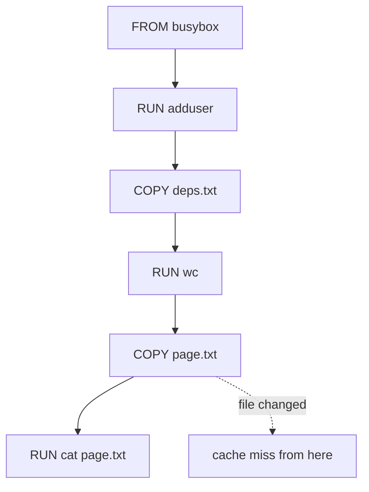

# Dockerfile Instructions And The Layer Cache

An image build is repeated many times a day. If every build starts from nothing, a one-line change costs minutes, and if the author does not know what each instruction stores, the image grows and leaks files. This part shows what the main Dockerfile instructions do, how the builder reuses earlier work, and how the build context controls which files the builder can see.

## What the builder does with a Dockerfile

A Dockerfile is a text file that lists build instructions. The image builder, here Podman, reads the instructions from top to bottom. A layer is a stored set of filesystem changes. The instructions `RUN`, `COPY` and `ADD` each create one layer. The other instructions only write settings into the image metadata, which is the part of the image that the container runtime reads when it starts a container.

The instructions used in this part are these:

- `FROM` selects the base image. Every later instruction starts from its filesystem.
- `RUN` runs a command during the build and stores the filesystem changes as a layer.
- `COPY` copies files from the build context into the image. `ADD` does the same and can also unpack a local archive or download a URL, so `COPY` is the safer choice.
- `WORKDIR` sets the directory for the following instructions and for the container process.
- `ENV` sets an environment variable that stays in the image and is present in every container.
- `ARG` sets a variable that exists only during the build.
- `USER` sets the user ID of the container process.
- `EXPOSE` records a port number as documentation. It does not publish or open the port.
- `CMD` records the default command that the container runs when it starts.

The build context is the directory that you pass to `podman build`. The builder can read only files inside it. A `.dockerignore` file in the context root lists patterns that the builder removes from the context before any instruction runs.

## Build an image and read its layers

The example below builds a small image for the `scout` page. Podman builds on your machine, so the cluster is needed only at the end. Create an empty directory and save the files in it.

Save this as `deps.txt`:

```text
alpha
beta
gamma
```

Save this as `page.txt`:

```text
scout page one
```

Save this as `Dockerfile`:

```dockerfile
FROM docker.io/library/busybox:1.37.0
RUN adduser -D -u 10001 app
WORKDIR /srv
ARG GREETING=hello
ENV GREETING=$GREETING
COPY deps.txt .
RUN wc -l < deps.txt > deps-count.txt
COPY page.txt .
RUN cat page.txt > index.html
USER 10001
EXPOSE 8080
CMD ["httpd", "-f", "-p", "8080", "-h", "/srv"]
```

<!-- astrona:playground:renew -->

Build the image. Podman prints one step for each instruction and a layer identifier for each step that creates a layer.

```sh
podman build -t localhost/ckad-scout-page:v1 .
```

The `-t` option gives the image a name and a tag. Run the same command a second time. The builder finds that every instruction and every input is unchanged, so it reuses the stored layer for each step instead of running the command again. The second build finishes in a fraction of the time, and the output says that it used the cache.

## How the cache decides

The cache key of a step is the instruction text plus its input. For `RUN`, the input is the instruction text and the layers below it. For `COPY` and `ADD`, the builder also reads the content of the copied files, so a changed file changes the key. When one step misses the cache, the builder runs it and every step after it again, because each layer depends on the layer below it.

Change the page and build again:

```sh
echo "scout page two" > page.txt
podman build -t localhost/ckad-scout-page:v1 .
```

The steps up to and including `COPY deps.txt .` and the `RUN wc` step use the cache. The step `COPY page.txt .` has a changed file, so it runs again, and the following `RUN cat page.txt` step runs again as well. The order of the file shows the rule. The dependency file comes before the page, so editing the page never repeats the dependency work. In a real project, the step that installs dependencies sits above the step that copies source code for the same reason.



When `page.txt` changes, the cache is valid down to the `RUN wc` step, and every step from `COPY page.txt` onward runs again.

## Build arguments and environment variables

`ARG` and `ENV` look alike but live in different places. An `ARG` value exists while the builder runs and is not part of the running container. An `ENV` value is stored in the image metadata, so every container started from the image has it. The Dockerfile above copies the build argument into an environment variable on purpose. Build with another value to see the difference:

```sh
podman build --build-arg GREETING=ahoy -t localhost/ckad-scout-page:v2 .
```

A changed build argument changes the cache key of every step after the `ARG` line that uses it, so the steps below it run again. Never put a password in `ARG` or `ENV`: both remain visible in the image history, which you can read with `podman history`.

## Ship the image to the cluster

The kind node has its own container runtime and cannot read your Podman storage. `podman save` writes the image to an archive file, and `kind load image-archive` copies that archive into the node. The playground cluster is named `astro-ats-027-playground-010-03`.

```sh
podman save -o scout-page.tar localhost/ckad-scout-page:v2
KIND_EXPERIMENTAL_PROVIDER=podman kind load image-archive scout-page.tar --name astro-ats-027-playground-010-03
```

Save this as `pod-scout-page.yaml`:

```yaml
apiVersion: v1
kind: Pod
metadata:
  name: scout-page
  namespace: starfleet
spec:
  containers:
  - name: web
    image: localhost/ckad-scout-page:v2
    imagePullPolicy: Never
```

Apply it:

```sh
kubectl apply -f pod-scout-page.yaml
```

Then check the result. The kubelet on the node asks the container runtime to start the image, and `imagePullPolicy: Never` stops the kubelet from trying to pull it from a registry that does not have it.

```sh
kubectl -n starfleet wait --for=condition=Ready pod/scout-page --timeout=60s
kubectl -n starfleet exec scout-page -- sh -c 'id -u; printenv GREETING; wget -q -O - http://127.0.0.1:8080/'
```

The command prints `10001`, then `ahoy`, then the page text `scout page two`. The `USER` instruction chose the user ID, the build argument became an environment variable, and the page comes from the layer that `RUN cat` wrote.

## Keep files out of the context

Everything in the build context is available to `COPY .`. A log file, a notes folder or a credential file in the directory would be copied together with the source. A `.dockerignore` file prevents this. Each line is a pattern, and the builder applies the patterns before the first instruction runs. A pattern such as `*.log` removes every log file in the context, and a pattern such as `notes/` removes the folder. Files removed this way cannot be copied by any instruction, and they do not change the cache key of `COPY . .`, so editing an ignored file does not invalidate the cache.

A common mistake is to copy a secret into an early layer and delete it in a later `RUN`. The delete only hides the file in the final filesystem. The earlier layer still contains it, and anyone with the image can extract it.

This part showed which instructions create layers, why instruction order controls the cache and how an image reaches a kind node. It leaves one problem open: a build often needs tools such as a compiler that the running container must not contain.

## Common pitfalls

> [!WARNING]
> - Putting `COPY . .` before the dependency step makes every source change repeat the dependency work.
> - Deleting a file in a later `RUN` does not remove it from the earlier layer. Keep the file out of the context or out of the stage instead.
> - `EXPOSE` does not open a port. The process must still listen on it, and a Service must still target it.
> - Loading an image with the same tag again does not restart running Pods. They keep the image they started with.
> - A user name in `USER` cannot be checked against a Kubernetes non-root requirement. Use a numeric ID.
