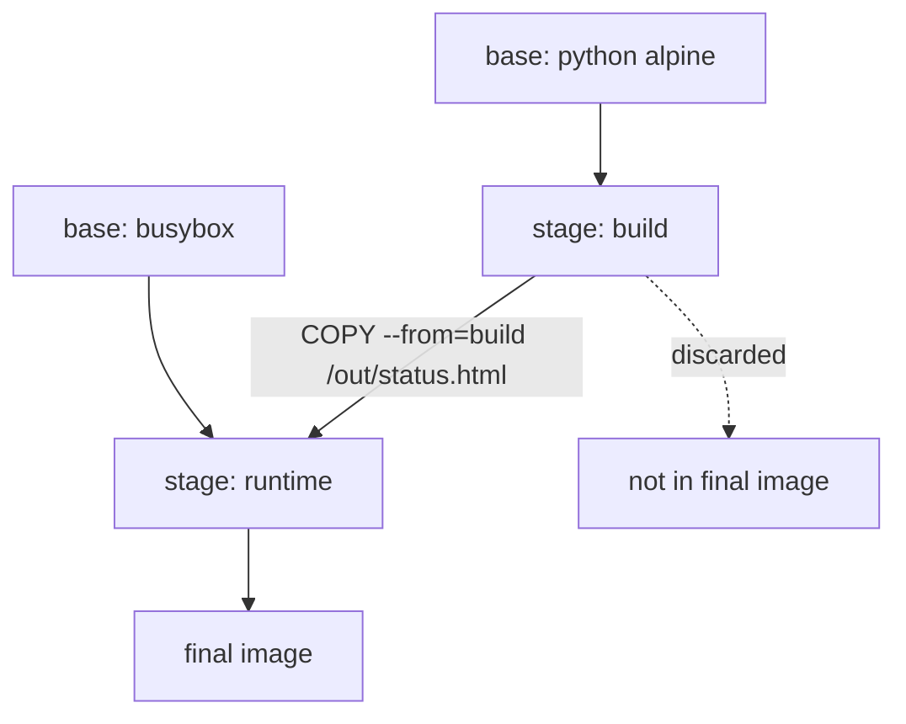

# Multi-Stage Builds And Small Images

Building software needs tools that running software does not: compilers, package managers, source files and test data. If one image holds both, the production image carries all of them. It is larger to pull, and it gives an attacker a compiler and a shell full of build files. This part shows how a multi-stage build separates the two jobs and how the final stage runs as a non-root user.

## Stages in one Dockerfile

A multi-stage Dockerfile contains more than one `FROM` instruction. Each `FROM` starts a new stage with its own base image and its own filesystem. The `AS` keyword gives a stage a name. The instruction `COPY --from=<stage>` copies a path out of an earlier stage into the current one. The builder keeps only the layers of the last stage in the final image. Everything that the last stage did not copy stays behind in the earlier stages and is discarded.

Consider a `scout` status page that a Python script generates. The script and its notes are needed once, while the image is built. The container only needs the generated file and a small web server. Create an empty directory and save these files in it.

Save this as `make_page.py`:

```python
from pathlib import Path

lines = Path("/src/crew.txt").read_text().split()
Path("/out").mkdir(exist_ok=True)
body = "".join(f"<li>{name}</li>" for name in lines)
Path("/out/status.html").write_text(f"<html><body><ul>{body}</ul></body></html>")
```

Save this as `crew.txt`:

```text
scout
probe
shuttle
```

Save this as `compiler-notes.txt`:

```text
build only
```

Save this as `Dockerfile`:

```dockerfile
FROM docker.io/library/python:3.13-alpine AS build
WORKDIR /src
COPY make_page.py crew.txt compiler-notes.txt ./
RUN python make_page.py

FROM docker.io/library/busybox:1.37.0 AS runtime
RUN adduser -D -u 10001 viewer
WORKDIR /srv
COPY --from=build /out/status.html ./index.html
USER 10001
EXPOSE 8080
CMD ["httpd", "-f", "-p", "8080", "-h", "/srv"]
```

The first stage is named `build` and the second is named `runtime`. The only link between them is the line `COPY --from=build /out/status.html ./index.html`. That line names one path, so the Python interpreter, `make_page.py`, `crew.txt` and `compiler-notes.txt` never enter the final stage.

<!-- astrona:playground:renew -->

Build the whole file. The builder runs both stages and tags the last one.

```sh
podman build -t localhost/ckad-status:v1 .
```

## Build a single stage with --target

The option `--target` tells the builder to stop after a named stage and tag that stage. This is the tool for looking inside the build stage and for comparing sizes.

```sh
podman build --target build -t localhost/ckad-status-build:v1 .
podman images --format '{{.Repository}}:{{.Tag}} {{.Size}}'
```

The listing shows both images. The build image is clearly larger, because it holds the Python base image, while the final image is based on busybox. The exact sizes depend on your machine and the base image versions, so compare the two numbers instead of expecting fixed values.

Now compare the contents. The next command lists the directory `/src` in the build image, and the one after it lists `/srv` in the final image:

```sh
podman run --rm localhost/ckad-status-build:v1 ls /src
podman run --rm localhost/ckad-status:v1 ls /srv
```

The first command lists the three source files. The second lists only `index.html`. The final image has no `/src` directory at all.



The final image is built from the `runtime` stage only. The `build` stage supplies one file and is then discarded.

## Run it in the cluster as a non-root user

The final stage creates the user `viewer` with ID 10001 and selects it with `USER 10001`. The container runtime starts the process with that ID, so the process cannot write to system paths. Port 8080 is above 1023, so a non-root process may listen on it.

Load the final image, then run it in the playground cluster. Save this as `pod-status.yaml`:

```yaml
apiVersion: v1
kind: Pod
metadata:
  name: status
  namespace: starfleet
spec:
  containers:
  - name: web
    image: localhost/ckad-status:v1
    imagePullPolicy: Never
    securityContext:
      runAsNonRoot: true
```

Apply it after loading the image:

```sh
podman save -o status.tar localhost/ckad-status:v1
KIND_EXPERIMENTAL_PROVIDER=podman kind load image-archive status.tar --name astro-ats-027-playground-010-03
kubectl apply -f pod-status.yaml
```

Then check the result. The kubelet checks `runAsNonRoot: true` before it starts the container. It can do that because the image declares a numeric user.

```sh
kubectl -n starfleet wait --for=condition=Ready pod/status --timeout=60s
kubectl -n starfleet exec status -- sh -c 'id -u; find / -xdev -name make_page.py -o -name crew.txt; wget -q -O - http://127.0.0.1:8080/'
```

The user ID is `10001`. The `find` prints nothing, because the build files are not in the image. The request returns the HTML list with `scout`, `probe` and `shuttle`.

If the `USER` line is removed, the process runs as user 0 and the kubelet refuses to start the container because of `runAsNonRoot: true`. The Pod then shows the reason `CreateContainerConfigError`.

You now know how a final image can hold only the output of a build, and how that image reaches a cluster and runs as a non-root user. The open question is what the container actually runs at start. That depends on `ENTRYPOINT` and `CMD`, and on what a Pod can override.

## Common pitfalls

> [!WARNING]
> - `COPY --from=build /src .` copies the whole source directory and defeats the purpose. Copy only the finished output.
> - A final stage that starts `FROM` the build stage keeps every build tool. The final stage needs its own small base.
> - The final stage runs as user 0 unless it sets `USER`. A multi-stage build does not change the user.
> - A binary built on one base can fail on a smaller base because a shared library is missing. Compare the libraries of both bases.
> - `--target` builds up to that stage only. The tagged image is the build stage, not the image you deploy.
