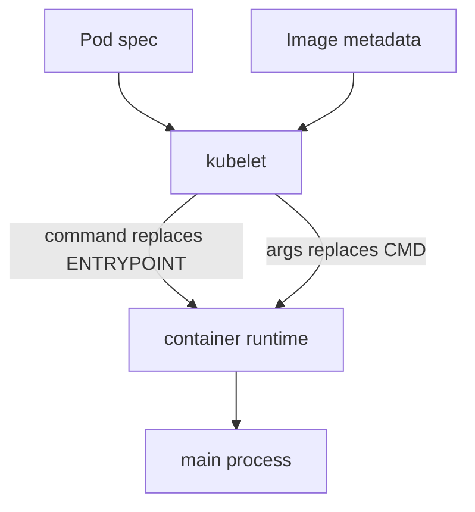

# ENTRYPOINT, CMD And Pod Command And Args

When a container starts, one program becomes its main process. People often change the image, the Pod specification or both, and then cannot explain why a port, a flag or a shell behaves differently. This part shows exactly which values the container runtime combines to build the command line, and which of them a Pod can replace.

## Where the start command comes from

A container image stores a default start command in its metadata. The instruction `ENTRYPOINT` sets the executable. The instruction `CMD` sets default arguments for it, or the full command if the image has no `ENTRYPOINT`. The image `localhost/ckad-probe:v1` in the playground contains these two lines:

```dockerfile
ENTRYPOINT ["httpd", "-f", "-h", "/www"]
CMD ["-p", "8080"]
```

The container runtime joins the two lists and starts `httpd -f -h /www -p 8080`. The flag `-f` keeps the busybox web server in the foreground, `-h` sets the directory it serves and `-p` sets the port. Your Podman storage holds this image because the playground script built it. You can read its stored defaults without running it.

<!-- astrona:playground:renew -->

```sh
podman image inspect --format '{{.Config.Entrypoint}} {{.Config.Cmd}}' localhost/ckad-probe:v1
```

The output shows the entry point list and the command list. Two lists exist because exec form stores each word separately.

## Exec form and shell form

Both instructions have two forms. Exec form is a JSON array, such as `["httpd", "-f"]`. The container runtime starts the first item as a program and passes the other items as arguments, without any shell. Shell form is a plain string, such as `CMD httpd -f`. The builder stores it as `/bin/sh -c "httpd -f"`, so a shell starts first and the shell starts the program.

The difference has practical consequences. A shell form needs `/bin/sh` inside the image, and a minimal image without a shell fails to start. The shell is the main process, so a termination signal that the kubelet sends goes to the shell first, and a shell does not always pass it on. A program started in exec form receives the signal directly and can shut down cleanly. Only shell form expands variables and handles pipes in the string, because only a shell does that work. For a long-running server, exec form is the normal choice.

## How a Pod overrides the image

A Pod container has two fields for the start command. The field `command` replaces the image `ENTRYPOINT`. The field `args` replaces the image `CMD`. The kubelet passes the final lists to the container runtime when it creates the container, so the image itself does not change.

| Pod `command` | Pod `args` | What runs |
| --- | --- | --- |
| not set | not set | image `ENTRYPOINT` and image `CMD` |
| not set | set | image `ENTRYPOINT` and the Pod `args` |
| set | not set | the Pod `command` only; image `CMD` is ignored |
| set | set | the Pod `command` and the Pod `args` |



The kubelet reads the image metadata and the Pod specification, applies the replacement rules and asks the container runtime to start the resulting process.

## Run the four cases

Save this as `pod-args-only.yaml`. It sets only `args`, so the image `ENTRYPOINT` stays and receives the new port:

```yaml
apiVersion: v1
kind: Pod
metadata:
  name: args-only
  namespace: starfleet
spec:
  containers:
  - name: web
    image: localhost/ckad-probe:v1
    imagePullPolicy: Never
    args:
    - -p
    - "9091"
```

Apply it:

```sh
kubectl apply -f pod-args-only.yaml
```

Save this as `pod-command-only.yaml`. It sets only `command`, so the image `CMD` with the port is dropped:

```yaml
apiVersion: v1
kind: Pod
metadata:
  name: command-only
  namespace: starfleet
spec:
  containers:
  - name: web
    image: localhost/ckad-probe:v1
    imagePullPolicy: Never
    command:
    - httpd
    - -f
    - -h
    - /www
```

Apply it:

```sh
kubectl apply -f pod-command-only.yaml
```

Then check the result. The process list of each container shows the command line that the runtime built.

```sh
kubectl -n starfleet wait --for=condition=Ready pod/args-only pod/command-only --timeout=60s
kubectl -n starfleet exec args-only -- ps
kubectl -n starfleet exec command-only -- ps
```

The process list of `args-only` contains `httpd -f -h /www -p 9091`: the image entry point followed by the Pod arguments. The list of `command-only` contains `httpd -f -h /www` and no `-p` option. Without a port option, busybox `httpd` listens on port 80, not on 8080. The image default `-p 8080` was discarded because the Pod set `command`. The process list shows more columns and shortened details, which this page leaves out.

## Why a pipe in command does not work

The lists in `command` and `args` go to the program as separate arguments. If you write `command: ["echo hello | tr a-z A-Z"]`, the runtime looks for a program with that whole string as its name and fails. To use a pipe, start a shell on purpose with `command: ["sh", "-c", "echo hello | tr a-z A-Z"]`. The shell then parses the third item. This is the same reason shell form needs a shell in the image: the parsing is done by `/bin/sh`, and not by Kubernetes.

You now know which component builds the command line and which values it joins. The open question is how to change the image itself, give it a new version and move that version into a running Deployment.

## Common pitfalls

> [!WARNING]
> - Setting `command` discards the image `CMD`, even when you did not set `args`. Include every argument that the program needs.
> - `args` alone is the safe way to change a flag, because the image `ENTRYPOINT` stays.
> - Shell form `CMD` runs under `/bin/sh -c`. A signal can reach the shell and not the program, which delays shutdown.
> - A pipe, a redirect or `$VARIABLE` inside a `command` item is passed as text. Start `sh -c` when you need shell parsing.
> - A changed port in `args` does not change `containerPort`, a Service `targetPort` or a readiness probe. Change those too.
