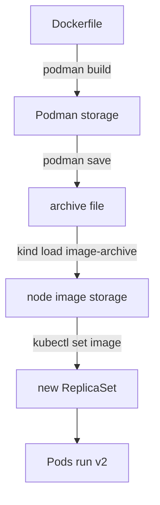

# Tagging, Loading And Updating An Image

A running Deployment cannot be edited by changing files inside its containers. Every change to the software means a new image, and the Deployment must be told to use it. This part follows a new image version from a Dockerfile on your machine to running Pods in the cluster, and shows how to check that the update worked and how to undo it.

## Derive a new version from an existing image

An image can be built on top of another image. The instruction `FROM localhost/ckad-probe:v1` makes the new image start with the complete filesystem and metadata of version 1. The metadata includes `ENTRYPOINT`, `CMD`, `ENV` and `USER`. The new Dockerfile only adds what is different. A tag is the human-readable name after the colon in an image reference. It points to one image at a time, and the owner of the name can move it.

Create an empty directory. Save this as `Dockerfile`:

```dockerfile
FROM localhost/ckad-probe:v1
RUN echo "image-version=v2" > /www/index.html
```

<!-- astrona:playground:renew -->

Build it with a new tag, and add a second tag to the same image. Both tags then refer to one image, and `podman images` lists them with the same image identifier.

```sh
podman build -t localhost/ckad-probe:v2 .
podman tag localhost/ckad-probe:v2 localhost/ckad-probe:stable
```

The build runs one step, the `RUN` line, because the base layers already exist. The new image has the `ENTRYPOINT` and `CMD` of version 1 without repeating them. Version 1 is unchanged, because a build never modifies the image named in `FROM`.

## Move the image into the cluster

The kind node runs its own container runtime with its own image storage. It cannot see your Podman storage and cannot reach `localhost` on your machine as a registry. The command `podman save` writes an image to an archive file. The command `kind load image-archive` imports that archive into every node of the named cluster. The playground cluster is named `astro-ats-027-playground-010-04`.

```sh
podman save -o probe-v2.tar localhost/ckad-probe:v2
KIND_EXPERIMENTAL_PROVIDER=podman kind load image-archive probe-v2.tar --name astro-ats-027-playground-010-04
```

The environment variable tells kind to use Podman as its container provider. Nothing in the cluster changes yet. The Deployment still runs version 1, and the new image only sits in the image storage of the node.

## Choose the pull policy

The field `imagePullPolicy` tells the kubelet when to contact a registry. With `Always`, the kubelet asks the registry on every container start. With `IfNotPresent`, it pulls only when the node does not have the image. With `Never`, it never pulls and starts the container only if the image is already on the node. If you do not set the field, Kubernetes uses `Always` when the tag is `latest` or missing, and `IfNotPresent` for every other tag.

Images in this playground exist only on the node, and `localhost/...` is not a registry. A policy of `Always` fails with an image pull error. `Never` is the correct choice, and the Deployment already uses it. If the image is missing on the node, the Pod shows the status `ErrImageNeverPull` instead of a pull attempt.

## Update the Deployment

The Deployment controller watches the Pod template of a Deployment. When the template changes, it creates a new ReplicaSet for the new template. It scales the new ReplicaSet up and the old one down in small steps, so the Service keeps at least some ready Pods during the change. A Pod is counted as ready only after its readiness probe succeeds.

The command `kubectl set image` changes the image of one container. The pair `web=localhost/ckad-probe:v2` names the container and the new image:

```sh
kubectl -n starfleet set image deployment/probe web=localhost/ckad-probe:v2
kubectl -n starfleet rollout status deployment/probe --timeout=120s
```

The API server stores the new template and the Deployment controller starts the rolling update. The command `rollout status` waits until all replicas run the new template and prints a message that the rollout completed. For a larger change, such as new `args` or a new port, run `kubectl -n starfleet edit deployment probe` and change the fields in the editor. The result is the same: a new template and a new rollout.

Check what the Pods serve and which image they run:

```sh
kubectl -n starfleet exec shuttle -- wget -q -O - http://probe.starfleet.svc.cluster.local/
kubectl -n starfleet get pods -l app=probe -o jsonpath='{range .items[*]}{.spec.containers[0].image}{"\n"}{end}'
```

The request returns `image-version=v2`, and both Pods report `localhost/ckad-probe:v2`. A Pod that shows `ErrImageNeverPull` means the archive was not loaded into this cluster, or it was loaded into a different cluster name.



The image travels from Podman storage through an archive into the node, and the update to the Deployment makes the Deployment controller start Pods from it.

## History, rollback and same-tag updates

Each change of the Pod template is a revision. The command `kubectl -n starfleet rollout history deployment/probe` lists the revisions, and `kubectl -n starfleet rollout undo deployment/probe` returns the Deployment to the previous template. The old ReplicaSet scales up again, so no image needs to be rebuilt. Changing only the replica count does not create a revision.

The tag deserves a warning. If you build different content, tag it `v2` again and load it, the Deployment template does not change, because the image string is the same. The controller does nothing, and running Pods keep their old content. Even a Pod that restarts may still use the image that is already on the node, when the pull policy is `IfNotPresent` or `Never`. A new tag for every new content, here `v3`, makes the change visible in the template and starts a rollout. The `imageID` field in a Pod status, which holds a content identifier, tells which content a container really started from.

You now know the full path of an image change: derive, tag, save, load, update, verify and, if needed, undo. This closes the question of how a changed image gets into a running Deployment.

## Common pitfalls

> [!WARNING]
> - `kind load image-archive` needs the exact cluster name, `astro-` followed by the environment name. A wrong name loads the image into another cluster or fails.
> - Re-using a tag for new content does not start a rollout, and running Pods keep the old image.
> - `imagePullPolicy: Always` on an image that exists only on the node ends in an image pull error. Use `Never` for locally loaded images.
> - A deriving Dockerfile that runs `RUN` as a non-root `USER` of the base image can fail on write permissions. Change to the user `root` for the step, then switch back.
> - Changing `args` without changing the port settings leaves the readiness probe checking the old port, and the new Pods never become ready.
