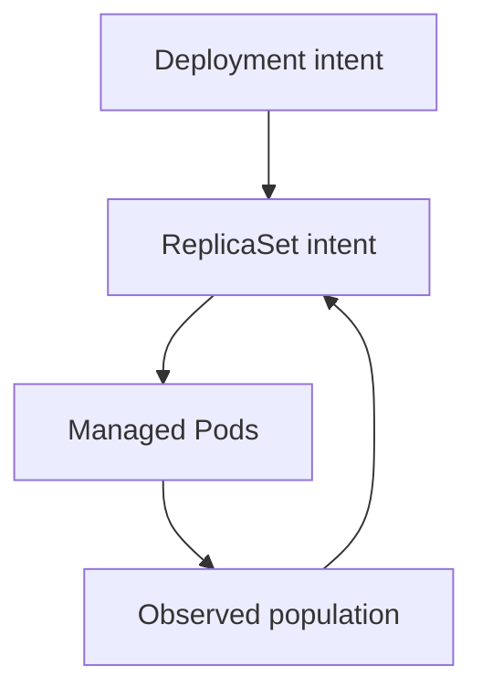

# Managing Long-Running Workloads

Deleting one managed `probe` Pod does not remove the application's requirement for two replicas. Its owner creates a replacement from the stored template. Knowing which controller owns that template explains where a lasting change belongs.

## Learning objectives

- Trace Pod ownership through ReplicaSet to Deployment.
- Explain why edits to child objects can be temporary.
- Choose a controller using identity and lifecycle requirements.

## Before you start

Use a shell on your own machine with the module playground running. A Pod is Kubernetes's unit for running one or more containers together. The environment provides the `probe` Deployment, which maintains application Pods, and the `starfleet` namespace, which groups these objects.

Read-only commands below use kubectl, the Kubernetes command-line tool. Select the private kubeconfig: the file that identifies this environment's cluster and credentials. The commands do not change the application.

## Managing Long-Running Workloads

A team needs four interchangeable `scout` web servers and controlled updates between versions. A Deployment manages a Pod template, replica count and rollout behavior for that application. A ReplicaSet maintains a requested number of matching Pods. The Deployment manages ReplicaSets so it can introduce a new template while reducing the previous replicas.

Pods are replaceable. A Deployment provides a suitable abstraction when each replica can serve the same role and no individual replica needs a stable identity. Replacing one server should not depend on recovering files from that particular Pod's writable container layer.

A StatefulSet manages Pods with stable ordinal names and supports stable storage associations. This is useful for applications that assign distinct identities or data to replicas. It does not configure database replication, choose a database leader or guarantee correct failover. The application still needs to implement those behaviors, and storage must provide the required properties.

A DaemonSet places a Pod on each eligible node, or a selected group of nodes. Node-level logging agents and network agents fit this pattern. Its desired count follows eligible nodes rather than a fixed replica count requested for a web application. Scheduling restrictions still affect which nodes are eligible.

Choose the controller by the workload's lifecycle. Interchangeable request handlers suggest a Deployment. Stable application members with individual storage suggest a StatefulSet. A node agent needed wherever workloads run suggests a DaemonSet. The fact that all three create Pods does not make their management contracts interchangeable.

A controller manages Kubernetes objects, not every external effect of the application. Recreating a Pod cannot recover unreplicated database data or guarantee that a request was processed exactly once. Controller choice and application design must agree.

## Choosing From Identity And Placement Requirements

A controller choice starts with the application's contract. If any healthy web replica can handle a request and durable sessions live elsewhere, a Deployment is a natural fit. The replicas can be replaced and reordered because individual names are not part of the application protocol. Its Pod template and rollout settings describe how those interchangeable instances should change.

A StatefulSet provides stable ordinal identity, such as a member ending in `-0` or `-1`. A database might use that identity to assign membership or associated storage. The stable name does not mean a particular physical process or node lives forever. The replacement must still start, reconnect its storage and participate correctly in the database's own protocol.

A DaemonSet instead relates the desired population to eligible nodes. When another eligible worker joins, another agent may be needed; when one leaves, that node's agent no longer has the same role. A fixed Deployment replica count cannot express this relationship merely by being set equal to today's node count. The counts would diverge when the node population changed.

## Controller Management And Application Responsibility

The Deployment-to-ReplicaSet relationship explains why directly changing a managed ReplicaSet can be temporary or misleading. The higher-level Deployment owns rollout intent and can reconcile its child resources. Similarly, changing one created Pod does not update the template for future replacements. Identify the object that owns the desired setting before describing an enduring change.

Controllers also differ from load balancing and storage services. A Deployment does not automatically make replicas discoverable from outside the cluster. A StatefulSet does not guarantee the storage backend can survive a zone outage. A DaemonSet does not grant every agent unrestricted host access without security implications.

Choose the controller by identity, population and lifecycle, then supply networking, storage and permissions separately. That produces a complete explanation: what should exist, why its instances are managed that way, how clients reach them and what application behavior remains outside the controller.

## Inspect the mechanism

A Pod records owner references, which identify the managing object. For this Deployment, a ReplicaSet owns the individual Pods and the Deployment owns that ReplicaSet. Each controller compares desired state with observed state and makes the changes within its responsibility. This repeated comparison is reconciliation.

An edit to one Pod does not update the template used for its replacement. An edit to a Deployment-owned ReplicaSet can also conflict with the Deployment's desired population. Follow ownership upward before deciding which specification to change. Kubernetes preserves replica intent, but the application must separately preserve data that cannot be lost when a replica disappears.



A child Pod is one realization of controller intent, so removing it does not erase that intent.

<!-- astrona:playground:renew -->

Select the private cluster connection and inspect the live state from your host shell:

```sh
export KUBECONFIG="$(astrona kubeconfig ats-027-playground-020-01)"
if test "$(kubectl config current-context)" = "kind-astro-ats-027-playground-020-01"; then
  kubectl -n starfleet get pods -l app=probe -o jsonpath='{range .items[*]}{.metadata.name}{" "}{.metadata.ownerReferences}{"\n"}{end}'
  kubectl -n starfleet get replicasets -l app=probe -o yaml
else
  printf "Select this module's private kubeconfig before continuing.\n" >&2
fi
```

Locate each Pod's ReplicaSet owner and that ReplicaSet's Deployment owner. Names include generated suffixes, so read the references rather than guessing the ownership chain from a shared prefix. This read-only observation explains replacement behavior without deleting a Pod. The desired count belongs to the controller contract; stable application data needs its own storage or external service.

You can now locate the owner of a durable workload change. Controller reconciliation restores declared population and templates, while storage, request correctness and external effects remain application responsibilities.

## Common pitfalls

> [!WARNING]
> StatefulSet provides stable identities and storage associations. It does not implement database replication or replace a backup strategy.
