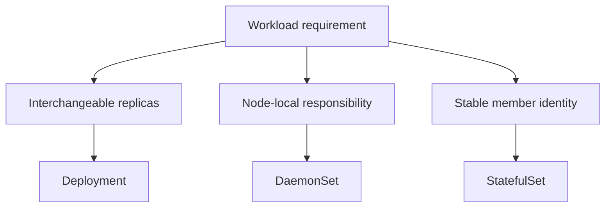

# Choosing Deployments, DaemonSets And StatefulSets

A frontend needs two interchangeable replicas, while a node collector needs one copy on each eligible worker. Both applications run in Pods, but their desired populations follow different rules. Choosing the controller starts with that difference.

## Learning objectives

- Choose Deployment, DaemonSet or StatefulSet for a stated requirement.
- Distinguish replica count from eligible-node population.
- Explain the limits of stable identity and storage association.

## Before you start

Use a shell on your own machine with the module playground running. A Pod is Kubernetes's unit for running one or more containers together. The environment provides the `probe` Deployment, which maintains application Pods, and the `starfleet` namespace, which groups these objects.

Read-only commands below use kubectl, the Kubernetes command-line tool. Select the private kubeconfig: the file that identifies this environment's cluster and credentials. The commands do not change the application.

## Choosing Deployments, DaemonSets and StatefulSets

A workload controller creates and manages Pods according to a desired pattern. A Pod is the smallest Kubernetes scheduling unit and can contain one or more containers. Choosing a controller means choosing the lifecycle and identity model that fits the application. Replica count alone does not describe all of those requirements.

## Interchangeable Application Replicas

A Deployment manages interchangeable replicas through ReplicaSets. Each replica normally has the same Pod template and can serve the same role. A stateless `scout` web application often fits this model because replacing a particular Pod does not require restoring that Pod's special identity.

The Deployment's selector identifies the Pods its ReplicaSets manage. The Pod template must contain labels that satisfy the selector. Service selection is a separate contract: a Service can select a subset or a broader set of those Pods, depending on its own selector. Correct controller ownership does not guarantee correct request routing.

A Pod template change can trigger a new rollout, whereas changing the desired replica count changes capacity without necessarily changing the template. When a controller recreates a deleted Pod, it uses its declared template rather than an unrecorded change to the deleted Pod. Understand the owner before reasoning about a replacement.

## A Copy On Eligible Nodes

A DaemonSet manages a Pod on each eligible node. This is useful for an agent whose job depends on observing or providing something on that node, such as a node-local log collector. Node selectors, affinity, taints and tolerations influence which nodes qualify; it is not a promise that every node always runs a usable agent.

Adding an eligible node can cause a corresponding Pod to appear. Removing the node removes the need for that copy. Setting an ordinary application replica count is therefore different from expressing a node-wide responsibility. A web application requiring three replicas across ten nodes usually does not need a DaemonSet merely because the copies should be distributed.

DaemonSet Pods remain ordinary workloads with resource requirements, permissions and startup behavior. A controller's purpose does not grant access to host files automatically. If an agent needs such access, the declared mounts and security privileges still determine what it can observe and what risk it introduces.

## Stable Identity And Storage Association

A StatefulSet manages Pods with stable ordinal names and a defined identity relationship. For example, members named `outpost-0` and `outpost-1` can remain recognizable across replacement. A headless Service commonly supports their network identity. Stable naming does not establish that a database has a safe replication or leader-election protocol.

Volume claim templates can associate separate persistent claims with members. A replacement member can use its existing claim, subject to storage availability and attachment rules. Scaling down a StatefulSet and deleting its Pods does not universally mean deleting the data; retention behavior must be understood explicitly.

Ordering also differs from a Deployment. The default ordered management behavior can make a later member wait for earlier members to become ready. Alternative management settings exist, but the application must tolerate the resulting lifecycle. A failed first member can therefore explain an apparent lack of progress in later members.

## Match The Controller To The Requirement

Compare three descriptions. A report frontend needs four interchangeable servers: a Deployment fits. A collector must run beside every eligible node's local workload: a DaemonSet fits. A clustered store needs stable member identities and member-specific claims: a StatefulSet may fit, provided the store's own recovery behavior is designed correctly.

These choices do not replace resource sizing, access control or network configuration. A StatefulSet cannot repair an application that assumes a failed member still owns a lease. A DaemonSet cannot bypass a missing image credential. Select the lifecycle first, then diagnose the independent conditions required for each Pod to run.

## Inspect the mechanism

A Deployment's replica count expresses an application population. A DaemonSet's population follows eligible nodes, as filtered by scheduling rules. A StatefulSet adds stable member identity and can associate claims with individual members. Those are management contracts, rather than different application executables.

Inspect the nodes and application placement without equating their counts. Two application replicas need not imply two nodes, and two nodes do not imply that a Deployment will keep one replica on each. A DaemonSet's contract fits a node-local responsibility; ordinary spreading rules can place Deployment replicas across nodes when the application instead needs independent capacity.



The population and identity requirements select the controller before networking or storage is added.

<!-- astrona:playground:renew -->

Select the private cluster connection and inspect the live state from your host shell:

```sh
export KUBECONFIG="$(astrona kubeconfig ats-027-playground-020-01)"
if test "$(kubectl config current-context)" = "kind-astro-ats-027-playground-020-01"; then
  kubectl get nodes
  kubectl -n starfleet get deployment probe
  kubectl -n starfleet get pods -l app=probe -o wide
  kubectl -n starfleet get daemonsets,statefulsets
else
  printf "Select this module's private kubeconfig before continuing.\n" >&2
fi
```

Compare desired replicas, actual Pod placement and available nodes. The baseline contains a Deployment; absent DaemonSets or StatefulSets are not missing requirements for this frontend. A stable ordinal name would establish member identity, not database replication. Read the installed resource kinds as evidence of lifecycle choices rather than assuming every example controller is already provisioned.

You can now justify a controller choice from the workload contract. The selected controller still requires scheduling capacity, useful permissions, reachable dependencies and an application that tolerates its replacement behavior.

## Common pitfalls

> [!WARNING]
> Stable identity does not make data durable by itself, and node-wide placement does not grant host access. Choose the controller for the application lifecycle, then evaluate storage, scheduling and permissions separately.
