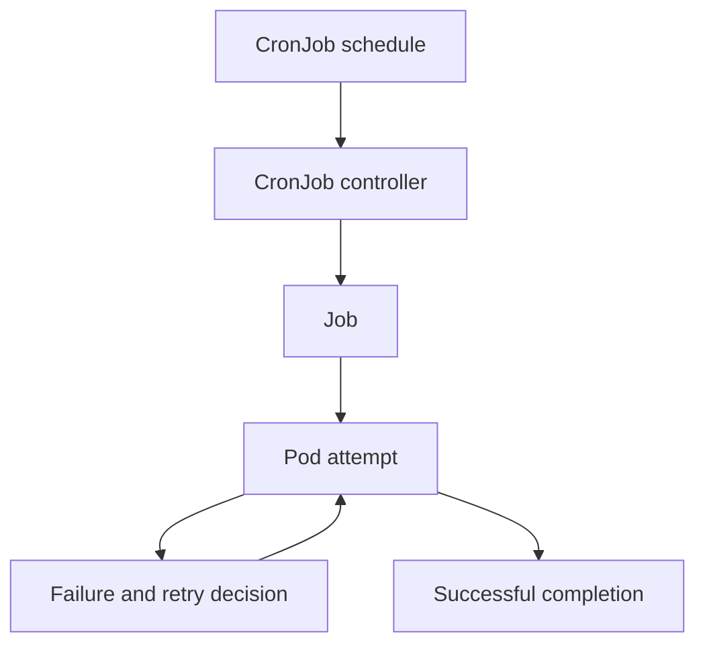

# Jobs, Retries And Scheduled Work

A report generator should exit after writing its output, while the `probe` web server should keep accepting requests. A Job tracks successful completion for the first case. A Deployment maintains continuous replicas for the second.

## Learning objectives

- Distinguish finite completion from continuous application availability.
- Explain Job retries, duration limits and completion counts.
- Predict the effect of CronJob overlap policies.

## Before you start

Use a shell on your own machine with the module playground running. A Pod is Kubernetes's unit for running one or more containers together. The environment provides the `probe` Deployment, which maintains application Pods, and the `starfleet` namespace, which groups these objects.

Read-only commands below use kubectl, the Kubernetes command-line tool. Select the private kubeconfig: the file that identifies this environment's cluster and credentials. The commands do not change the application.

## Jobs, Retries and Scheduled Work

A Job manages work intended to finish successfully rather than run forever. It tracks successful completion and can create replacement Pods when attempts fail. A CronJob creates Jobs according to a schedule. These controllers address different questions: whether a task finishes and when new instances of that task should begin.

## Completion And Parallelism

A Job's `completions` describes the required number of successful Pod completions for applicable completion modes. `parallelism` limits how many Pods should run concurrently. A report batch can require several completed work units while allowing only two active workers at a time. These fields do not themselves split application input into correctly assigned work.

The process exit status contributes to whether a Pod attempt succeeded. A process that exits successfully before writing its intended result can still appear successful to Kubernetes. Application-level completion must therefore be reflected in the process behavior or another designed verification mechanism.

Pod restart policy and Job retries operate at different levels. With `OnFailure`, a failed container can restart inside a Pod. With `Never`, a failed container does not restart under that policy, and the Job can create another Pod attempt when appropriate. A Job does not use the always-restarting lifecycle typical of a Deployment's long-running service.

## Bound Failure And Duration

`backoffLimit` bounds retry behavior under the applicable Job semantics. `activeDeadlineSeconds` sets a maximum active duration for the Job. A deadline can end work even when retries remain. Treating these as interchangeable controls can leave a batch retrying longer than its business window allows.

A replacement attempt can repeat an operation that already produced an external side effect. Idempotence means repeating the operation does not produce an unintended additional effect. A task writing a uniquely identified report can check whether that report was already completed, rather than charging a customer again merely because an earlier worker disappeared before recording success.

A Job's completion does not automatically remove all related objects immediately. A time-to-live setting for finished Jobs can arrange later cleanup. Deleting old execution objects is different from deleting report data stored in a persistent backend. Retention needs must include both diagnostic evidence and the application's output.

## Scheduling With CronJobs

A CronJob schedule selects times when the controller should create Jobs. The schedule and configured time zone determine intended timing. Controller delays, missed times and operational interruptions mean scheduled work should tolerate conditions beyond an ideal clock. A CronJob is not an exact-once external transaction system.

`concurrencyPolicy` controls overlapping Jobs created by that CronJob. `Allow` permits overlap, `Forbid` avoids starting overlapping scheduled runs, and `Replace` replaces an active run when the next run is due. This policy does not serialize unrelated Jobs, and ending one worker does not undo external operations it already performed.

`startingDeadlineSeconds` bounds how late a missed start may be considered. Suspending a CronJob stops new scheduling while preserving the specification and does not itself stop Jobs already running. Changing the CronJob's template affects future Jobs; it does not retroactively rewrite an existing Job's Pods.

## Work Through A Scheduling Decision

Suppose a report task takes twelve minutes and is scheduled every five minutes. Under `Allow`, multiple Jobs can overlap. Under `Forbid`, some due executions can be skipped while an earlier Job is active. Under `Replace`, unfinished work can be interrupted repeatedly. None of those choices fixes a task whose required runtime fundamentally exceeds its delivery window.

Choose the overlap policy according to whether concurrent work is safe, whether skipping a run is acceptable and whether interruption loses required progress. Then bound retries, make external writes safe to repeat and retain enough evidence to explain failed attempts. The correct controller configuration follows those application requirements.

## Inspect the mechanism

A CronJob stores a schedule and a Job template. When a due execution is eligible, its controller creates a Job; the Job controller then manages attempts toward completion. Editing the CronJob template affects later Jobs, not already created attempts. Suspending the schedule likewise stops new scheduling rather than undoing an active worker's effects.

Completion is based on process and Pod outcomes under the controller's rules. If a worker writes to an external database and then crashes before recording success, a retry can repeat that write. An idempotent operation produces an acceptable result when repeated. Neither a retry budget nor an overlap policy makes a non-idempotent external operation exactly once.



Scheduling creates a Job, while completion and retries belong to that Job's execution lifecycle.

<!-- astrona:playground:renew -->

Select the private cluster connection and inspect the live state from your host shell:

```sh
export KUBECONFIG="$(astrona kubeconfig ats-027-playground-020-02)"
if test "$(kubectl config current-context)" = "kind-astro-ats-027-playground-020-02"; then
  kubectl -n starfleet get jobs,cronjobs
  kubectl -n starfleet get deployment probe
  kubectl -n starfleet get pods -l app=probe
else
  printf "Select this module's private kubeconfig before continuing.\n" >&2
fi
```

The baseline has continuous application replicas; finite and scheduled resources appear when you create them deliberately. An empty Job list is therefore expected starting state, not proof that scheduling failed. Compare the long-running Pod lifecycle with the completion fields of any Jobs present after experimentation. The commands do not create scheduled work or repeat external effects.

You can now distinguish when work begins from whether it finishes correctly. Retry limits, deadlines, overlap policy and safe repeated writes each address a separate part of that contract.

## Common pitfalls

> [!WARNING]
> A schedule does not guarantee exact-once execution. Retry limits, duration limits, overlap policy and application idempotence solve different problems and must be considered together.
