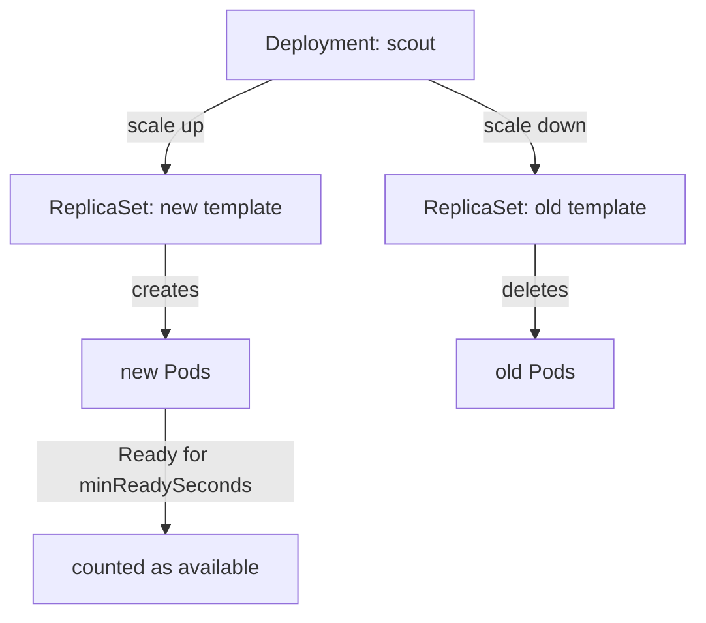

# Rolling Updates And Rollout Control

A container image is never final. A new version of the `probe` application is released, and the running Pods must change without users noticing. Deleting Pods by hand and creating new ones is slow and risky, because nobody checks that the new Pods work before the old ones disappear. The Deployment controller solves this by replacing Pods in controlled steps and checking each step. This part explains how it does that.

## One ReplicaSet for each revision

A Deployment does not create Pods itself. The Deployment controller, which runs inside the `kube-controller-manager`, creates a ReplicaSet. A ReplicaSet is an object that keeps a fixed number of identical Pods running. The ReplicaSet controller, also part of the `kube-controller-manager`, creates and deletes the Pods. The scheduler then places each new Pod on a node, and the kubelet on that node starts the containers through the container runtime.

The name of a ReplicaSet is the name of its Deployment plus a hash of the Pod template. The Pod template is the `spec.template` field of the Deployment, and it describes the Pods to create. When any part of the template changes, the hash changes, and the controller needs a different ReplicaSet. One ReplicaSet therefore matches exactly one version of the template. This version is called a revision.

Start with the playground and look at the ReplicaSet that already exists for the `probe` Deployment. The label `pod-template-hash` on each Pod tells you which ReplicaSet created it.

<!-- astrona:playground:renew -->

```sh
kubectl -n starfleet get deployment probe
kubectl -n starfleet get replicaset -l app=probe
```

You should see one Deployment with three ready replicas and one ReplicaSet with a desired count of three. Now change the template by setting an environment variable. The command sends a patch to the API server, the Deployment controller sees a new template hash, and it creates a second ReplicaSet.

```sh
kubectl -n starfleet set env deployment/probe VERSION=v2
kubectl -n starfleet rollout status deployment/probe
kubectl -n starfleet get replicaset -l app=probe
```

The `rollout status` command waits until the rollout is finished. Afterwards two ReplicaSets exist. The new one has three Pods. The old one still exists, but its desired count is zero. The controller keeps the old ReplicaSet on purpose, because it holds the template of the previous revision. This is what makes a rollback possible later.

Only a change to `spec.template` creates a revision. Changing `spec.replicas` does not change the hash, so scaling never creates a new ReplicaSet. Changing a label on the Deployment object itself, or an annotation on it, does not either.

## How a rolling update moves Pods

The default strategy of a Deployment is `RollingUpdate`. During a rolling update, the controller scales the new ReplicaSet up and the old ReplicaSet down in several small steps. Two fields in `spec.strategy.rollingUpdate` limit the size of each step.

- `maxSurge` is the number of Pods that may exist above the desired replica count during the update. A value of `1` means one extra Pod. A percentage is rounded up.
- `maxUnavailable` is the number of Pods that may be missing from the desired count during the update. A percentage is rounded down.

Both default to 25 percent. Both cannot be zero at the same time, because then the controller could never start a new Pod and could never stop an old one. With three replicas, the defaults give `maxSurge` of 1 (0.75 rounded up) and `maxUnavailable` of 0 (0.75 rounded down).



The diagram shows that the Deployment controller drives both ReplicaSets, and that a new Pod counts as available only after it is ready.

The other strategy is `Recreate`. With `Recreate`, the controller first scales the old ReplicaSet to zero and waits until its Pods are gone. Only then does it create the new Pods. The application is fully down between the two steps. Use `Recreate` only when two versions must never run at the same time, for example when both versions would write to the same single-writer volume or run a database schema migration that the old version cannot read.

## Readiness gates every step

The controller does not move to the next step until the new Pods are available. A Pod is ready when its containers are running and its readiness probe succeeds. A readiness probe is a check that the kubelet runs against a container, and its result decides whether the Pod receives traffic from Services. A Pod without a readiness probe is ready as soon as its containers start, so the rollout moves quickly even if the application is not yet working.

The field `minReadySeconds` adds a delay. A ready Pod counts as available only after it has been ready for that many seconds without any container crashing. The default is zero. A small value, such as ten seconds, catches applications that start correctly and then crash soon after.

A third field, `progressDeadlineSeconds`, sets how long the controller waits for progress. The default is 600 seconds. If a rollout makes no progress for that time, the controller sets the condition `Progressing` to `False` with the reason `ProgressDeadlineExceeded`. The controller only reports the failure. It does not roll back by itself, and it does not delete the new Pods.

Save this as `deployment-scout.yaml`. It sets every field discussed so far on a new Deployment named `scout`:

```yaml
apiVersion: apps/v1
kind: Deployment
metadata:
  name: scout
  namespace: starfleet
spec:
  replicas: 3
  revisionHistoryLimit: 3
  minReadySeconds: 10
  progressDeadlineSeconds: 120
  strategy:
    type: RollingUpdate
    rollingUpdate:
      maxSurge: 1
      maxUnavailable: 0
  selector:
    matchLabels:
      app: scout
  template:
    metadata:
      labels:
        app: scout
    spec:
      containers:
      - name: scout
        image: docker.io/library/busybox:1.37.0
        command: ["sh", "-c", "touch /tmp/ready; sleep 3600"]
        env:
        - name: VERSION
          value: v1
        readinessProbe:
          exec:
            command: ["cat", "/tmp/ready"]
          periodSeconds: 2
```

Apply it:

```sh
kubectl apply -f deployment-scout.yaml
```

Then check the result:

```sh
kubectl -n starfleet rollout status deployment/scout
kubectl -n starfleet get deployment scout -o jsonpath='{.spec.strategy}{"\n"}'
```

The rollout waits at least ten seconds before it reports success, because each Pod must stay ready for `minReadySeconds`. The second command prints the strategy as stored by the API server. The field `revisionHistoryLimit` set to `3` tells the controller to keep at most three old ReplicaSets with zero Pods. The default is ten.

## Watching, pausing and resuming

Changing the template of `scout` starts a rollout. In a second terminal, run `kubectl -n starfleet get pods -l app=scout -w` while you run the next command. You will see one new Pod appear first, and an old Pod terminate only after the new one is available. This order follows from `maxUnavailable: 0`.

```sh
kubectl -n starfleet set env deployment/scout VERSION=v2
kubectl -n starfleet rollout status deployment/scout
kubectl -n starfleet rollout history deployment/scout
```

The history lists one line for each revision that still has a ReplicaSet. Now try the pause feature. A paused Deployment accepts template changes but the controller does not act on them. This lets you make several edits and start one rollout instead of many.

```sh
kubectl -n starfleet rollout pause deployment/scout
kubectl -n starfleet set env deployment/scout VERSION=v3
kubectl -n starfleet get replicaset -l app=scout
kubectl -n starfleet rollout resume deployment/scout
```

While the Deployment is paused, no third ReplicaSet appears and the Pods keep running version `v2`. After `resume`, the controller sees the changed template, creates the new ReplicaSet and runs the rollout.

You now know that each template change becomes a ReplicaSet, that `maxSurge` and `maxUnavailable` set the pace, and that readiness, `minReadySeconds` and `progressDeadlineSeconds` decide whether each step counts. The next question is what to do when the number of replicas must change, or when a revision turns out to be wrong.

## Common pitfalls

> [!WARNING]
> - A Deployment without a readiness probe reports success as soon as the containers start. A broken application can replace every working Pod this way. Add a readiness probe to anything that is updated with a rolling update.
> - Setting `maxSurge: 0` and `maxUnavailable: 0` together is rejected by the API server. Setting only `maxUnavailable: 0` needs spare capacity on the nodes for the extra Pod, or the rollout waits.
> - `ProgressDeadlineExceeded` does not stop or undo the rollout. The new Pods keep trying, and the old Pods keep serving. Check the condition and decide on the next step yourself.
> - `kubectl rollout pause` does not stop Pods that already exist. It only stops new rollouts from starting. Forgetting to resume leaves later changes unapplied.
