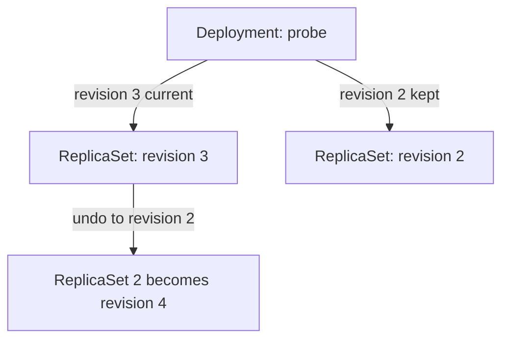

# Scaling And Rollback

Two things happen to a Deployment more often than a new release: the load changes, and a release turns out to be wrong. For the first, the number of replicas must change quickly. For the second, the cluster must return to a version that worked. Both are normal operations, and both are done by the same controller that performs updates. This part shows how scaling works, who owns the `replicas` field, and how to roll back and diagnose a rollout that does not finish.

## Scaling a Deployment

Scaling means changing `spec.replicas`. The `kubectl scale` command sends this change to the API server through the scale subresource of the Deployment. The Deployment controller sees the new value and passes it to the current ReplicaSet. The ReplicaSet controller then creates or deletes Pods, and the scheduler places the new Pods.

Scaling does not change the Pod template, so it does not create a new revision. Start with the `probe` Deployment from the playground and scale it up.

<!-- astrona:playground:renew -->

```sh
kubectl -n starfleet scale deployment/probe --replicas=5
kubectl -n starfleet get deployment probe
```

The `READY` column moves from three of three to five of five as the new Pods pass their readiness probes. If you scale during a rolling update, the controller spreads the added replicas across the old and the new ReplicaSet in proportion to their sizes. This is called proportional scaling, and it keeps the update going instead of restarting it.

### Who owns the replicas field

The `replicas` field can be written by more than one tool, and the last writer wins. If you keep a Deployment manifest in a file with `replicas: 3`, then `kubectl scale` sets it to five, and the next `kubectl apply -f` of the file sets it back to three. A HorizontalPodAutoscaler, an object that changes the replica count based on measured load, also writes this field. When an autoscaler manages a Deployment, leave `replicas` out of the manifest. Then `kubectl apply` does not touch the value, and the autoscaler stays the only writer.

Check the current value, and then set it back to three:

```sh
kubectl -n starfleet get deployment probe -o jsonpath='{.spec.replicas}{"\n"}'
kubectl -n starfleet scale deployment/probe --replicas=3
```

## Revision history and the change cause

Every revision that still has a ReplicaSet appears in the rollout history. The number of old ReplicaSets that the controller keeps is `revisionHistoryLimit`, with a default of ten. Each ReplicaSet carries the annotation `deployment.kubernetes.io/revision` with its number.

The history shows a column named `CHANGE-CAUSE`. The value comes from the annotation `kubernetes.io/change-cause` on the Deployment, and the controller copies it to the new revision when a rollout starts. The annotation is not set automatically. You set it before the change, so that the history says why each revision exists.

```sh
kubectl -n starfleet annotate deployment/probe kubernetes.io/change-cause="set VERSION to v4" --overwrite
kubectl -n starfleet set env deployment/probe VERSION=v4
kubectl -n starfleet rollout status deployment/probe
kubectl -n starfleet rollout history deployment/probe
```

The newest revision now shows the text you wrote. Older revisions show `<none>` when nobody set the annotation.

## Rolling back

A rollback is a rollout to an older template. The command `kubectl rollout undo` finds an earlier ReplicaSet in the history, copies its Pod template into the Deployment, and the controller then runs a normal rolling update with the same strategy. The old ReplicaSet is scaled up and the current one is scaled down. Without an argument, the command goes back one revision. With `--to-revision`, it goes to the revision you name.

Revision numbers never repeat. When you roll back to revision two, the ReplicaSet of revision two gets a new, higher number, and the old number disappears from the list. List the revisions and look at one of them before you choose. Replace `<REVISION>` with a number from the first command:

```sh
kubectl -n starfleet rollout history deployment/probe
kubectl -n starfleet rollout history deployment/probe --revision=<REVISION>
kubectl -n starfleet rollout undo deployment/probe --to-revision=<REVISION>
kubectl -n starfleet rollout status deployment/probe
```

The second command prints the template of that revision, including the environment variable. After the rollback finishes, the `VERSION` value of the Pods matches the revision you chose.



The diagram shows that a rollback reuses an old ReplicaSet and gives it the next revision number instead of creating a copy.

## Diagnosing a rollout that does not finish

A release can fail because the image does not exist, the container crashes or the readiness probe never passes. In each case the rolling update stops at the first step. The new Pod is not available, so the controller never scales the old ReplicaSet down further. The old Pods keep serving traffic, so users are protected, but the rollout is stuck.

Reproduce this with an image tag that does not exist. First shorten the deadline to 30 seconds so that the failure shows quickly.

```sh
kubectl -n starfleet patch deployment/probe -p '{"spec":{"progressDeadlineSeconds":30}}'
kubectl -n starfleet set image deployment/probe probe=docker.io/library/busybox:does-not-exist
kubectl -n starfleet rollout status deployment/probe --timeout=60s
```

The status command prints that it is waiting, and after the deadline it ends with an error that the progress deadline was exceeded. Look at the Pods and at the Deployment conditions to find the cause:

```sh
kubectl -n starfleet get pods -l app=probe
kubectl -n starfleet describe deployment probe
```

One new Pod is in `ErrImagePull` or `ImagePullBackOff`, because the container runtime on the node could not pull the image. The other Pods are the old ones and still run. The description shows the condition `Progressing` as `False` with the reason `ProgressDeadlineExceeded`. The events of the Pod, shown by `kubectl describe pod`, give the exact pull error from the kubelet.

The way out is the rollback command. Run `kubectl -n starfleet rollout undo deployment/probe`, which goes back one revision to the last template that worked. After it finishes, the failed ReplicaSet is scaled to zero, and the Deployment is healthy again.

You can now scale a Deployment, explain who owns its replica count, read and annotate the history, return to a chosen revision and read the signs of a stuck rollout. Which strategy values make a rollout safer is a design choice, and it depends on how much spare capacity the cluster has.

## Common pitfalls

> [!WARNING]
> - `kubectl rollout undo` to the current revision does nothing. Always read the history first, because revision numbers change after every rollback.
> - If `revisionHistoryLimit` is `0`, no old ReplicaSets exist, and a rollback is not possible.
> - Re-applying a manifest that contains `replicas` silently undoes a manual `kubectl scale` and the work of an autoscaler.
> - `kubectl rollout undo` rolls back the Pod template only. It does not undo a change to `replicas`, the strategy or other Deployment fields.
> - The `--record` flag of `kubectl` is deprecated. Set the `kubernetes.io/change-cause` annotation instead.
