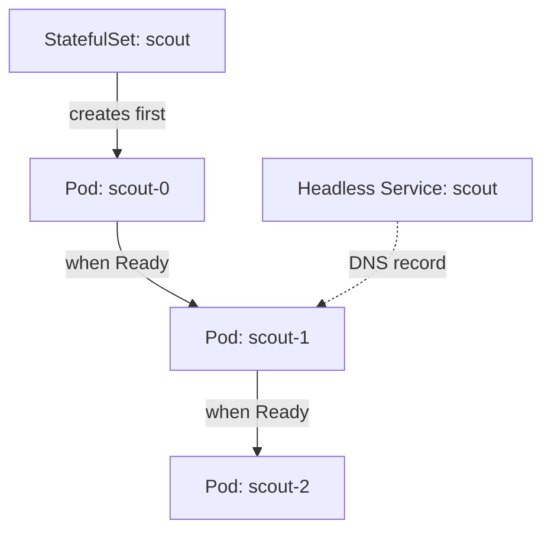

# Stable Names And Headless Services

A clustered application often needs one member to talk to one specific other member. A new replica must contact the first replica to join the cluster. A client must write only to the primary. With Deployment Pods this is not possible, because the Pod `probe-7d9f8-x2k4q` is deleted and replaced by a Pod with a different random name and a different IP address. A StatefulSet solves the naming problem. This part explains how it names Pods, how a headless Service publishes those names in DNS, and how the Pods are started.

## Ordinal names

A StatefulSet is a workload resource that creates Pods from one template, like a ReplicaSet does. The difference is identity. The StatefulSet controller, which runs in the `kube-controller-manager`, creates each Pod with the name of the StatefulSet, a dash and an ordinal number. An ordinal is an integer that starts at zero. A StatefulSet called `scout` with three replicas has the Pods `scout-0`, `scout-1` and `scout-2`.

The name belongs to the position, not to a particular Pod object. When `scout-1` is deleted, the controller creates a new Pod with the name `scout-1`. The new Pod gets a new IP address, but it keeps the name, the same hostname inside the container and the same storage claim. A Pod with a given ordinal exists only once at a time.

## Headless Services and DNS

A normal Service has a cluster IP address, and the proxy on each node spreads requests over the Pods behind it. For a StatefulSet that is wrong, because the client wants to choose the Pod. A headless Service is a Service with `clusterIP: None`. It has no virtual IP. The cluster DNS server answers a lookup of the Service name with the IP addresses of all ready Pods, and it creates one more DNS record for each Pod.

The field `serviceName` of the StatefulSet names the headless Service that governs the Pods. The StatefulSet controller sets the hostname of each Pod to its name and the subdomain to the Service name. The Pod then has this DNS name:

`<pod-name>.<service-name>.<namespace>.svc.cluster.local`

For `scout-1` in the namespace `starfleet`, that is `scout-1.scout.starfleet.svc.cluster.local`. The Service must exist, and its selector must match the Pod labels, otherwise no record is created. Kubernetes does not create the Service for you.

Save this as `statefulset-scout.yaml`. It holds the headless Service and the StatefulSet. The readiness probe passes ten seconds after the container starts, so you can watch the ordering below.

<!-- astrona:playground:renew -->

```yaml
apiVersion: v1
kind: Service
metadata:
  name: scout
  namespace: starfleet
spec:
  clusterIP: None
  selector:
    app: scout
  ports:
  - name: tcp
    port: 8080
---
apiVersion: apps/v1
kind: StatefulSet
metadata:
  name: scout
  namespace: starfleet
spec:
  serviceName: scout
  replicas: 3
  selector:
    matchLabels:
      app: scout
  template:
    metadata:
      labels:
        app: scout
    spec:
      containers:
      - name: scout
        image: docker.io/library/busybox:1.37.0
        command: ["sh", "-c", "sleep 10; touch /tmp/ready; sleep 3600"]
        readinessProbe:
          exec:
            command: ["cat", "/tmp/ready"]
          periodSeconds: 2
```

Apply it:

```sh
kubectl apply -f statefulset-scout.yaml
```

Then check the result. Run the first command several times in the first thirty seconds:

```sh
kubectl -n starfleet get pods -l app=scout
kubectl -n starfleet rollout status statefulset/scout
```

You should see `scout-0` first. The Pod `scout-1` does not appear until `scout-0` is ready, and `scout-2` waits for `scout-1`. This is the default behaviour, explained below.



The diagram shows that each Pod waits for the one before it, and that the headless Service publishes a DNS record for each Pod.

## Looking up a Pod by name

The `drifter` Pod in the `outpost` namespace is a client outside the StatefulSet. It asks the cluster DNS server for the Pod record and for the Service record. The server for the cluster is CoreDNS.

```sh
kubectl -n outpost exec deploy/drifter -- nslookup scout-1.scout.starfleet.svc.cluster.local
kubectl -n outpost exec deploy/drifter -- nslookup scout.starfleet.svc.cluster.local
kubectl -n starfleet get pods -l app=scout -o wide
```

The first lookup returns exactly one address, the IP of `scout-1`. The second returns the addresses of all three Pods. Compare them to the `IP` column of the last command. Now delete one Pod and watch the controller replace it:

```sh
kubectl -n starfleet delete pod scout-1
kubectl -n starfleet get pods -l app=scout -o wide
```

A new `scout-1` appears with the same name and a new IP address. DNS follows the change after the new Pod is ready, because the endpoints of the headless Service are updated. The name is stable, but the address is not. Clients must use the name.

## Pod management policy

The field `podManagementPolicy` controls how the controller creates and deletes Pods. The default is `OrderedReady`. The controller creates Pods in order from zero, waits until each Pod is running and ready before it creates the next, and deletes them in the reverse order. This suits applications where member two needs member one to exist, such as a database that bootstraps one node at a time.

The other value is `Parallel`. The controller then creates or deletes all Pods at the same time and does not wait for readiness. The names, DNS records and claims are the same. Only the timing changes. Use it for members that do not depend on each other and should start quickly. The policy cannot be changed after the StatefulSet exists, and it affects scaling only, not updates.

Save this as `statefulset-shuttle.yaml`:

```yaml
apiVersion: v1
kind: Service
metadata:
  name: shuttle
  namespace: starfleet
spec:
  clusterIP: None
  selector:
    app: shuttle
  ports:
  - name: tcp
    port: 8080
---
apiVersion: apps/v1
kind: StatefulSet
metadata:
  name: shuttle
  namespace: starfleet
spec:
  serviceName: shuttle
  podManagementPolicy: Parallel
  replicas: 3
  selector:
    matchLabels:
      app: shuttle
  template:
    metadata:
      labels:
        app: shuttle
    spec:
      containers:
      - name: shuttle
        image: docker.io/library/busybox:1.37.0
        command: ["sh", "-c", "sleep 10; touch /tmp/ready; sleep 3600"]
        readinessProbe:
          exec:
            command: ["cat", "/tmp/ready"]
          periodSeconds: 2
```

Apply it:

```sh
kubectl apply -f statefulset-shuttle.yaml
```

Then check the result right away:

```sh
kubectl -n starfleet get pods -l app=shuttle
```

All three Pods exist at once, although none is ready yet. With the default policy only one Pod would exist at this moment.

You now know that a StatefulSet gives each Pod a fixed name, that a headless Service turns those names into DNS records, and that the management policy sets the start order. The Pods still have no storage of their own. The next question is how each Pod keeps its data.

## Common pitfalls

> [!WARNING]
> - If the headless Service named in `serviceName` does not exist, the StatefulSet still creates Pods, but the per-Pod DNS names do not resolve.
> - The Service selector must match the Pod template labels. A selector that matches nothing gives no DNS records.
> - With `OrderedReady`, one Pod that never becomes ready blocks every Pod after it. Scaling up then stops silently at that Pod.
> - A client that stores a Pod IP address breaks when the Pod is replaced. Use the DNS name.
> - `podManagementPolicy` cannot be changed on an existing StatefulSet. Delete and create it again.
