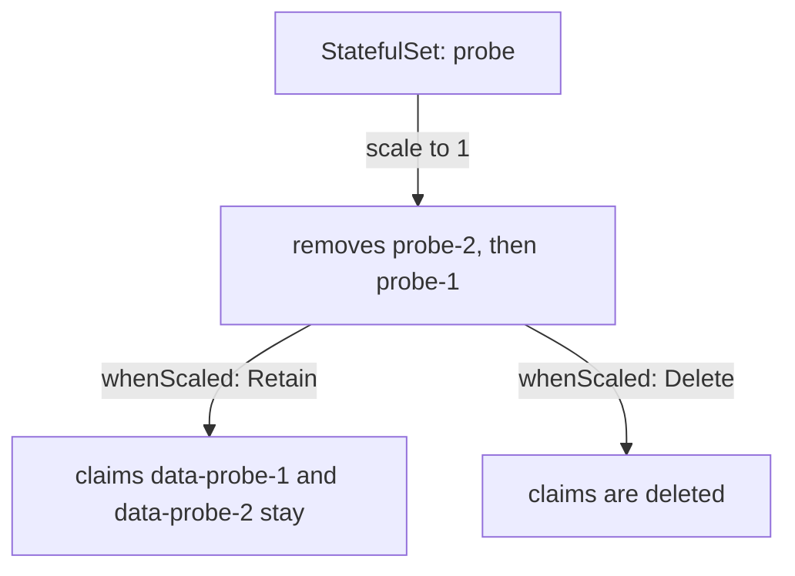

# Volume Claim Templates And Ordered Updates

A stable name is only half of an identity. A database replica that restarts under the same name must also find its data. If the Pod got an empty disk each time, the name would mean nothing. A StatefulSet therefore creates a separate PersistentVolumeClaim for each Pod and attaches the same claim again whenever the Pod is replaced. This part shows how that works, how a StatefulSet is updated one Pod at a time, and what happens to the storage when the StatefulSet shrinks.

## One claim for each Pod

A PersistentVolumeClaim, or PVC, is a request for storage from the cluster. A PersistentVolume is the storage that satisfies the request, and a StorageClass tells a provisioner how to create it. In the playground the StorageClass `standard` creates a volume on the node when a claim needs it.

The field `volumeClaimTemplates` of a StatefulSet holds one or more claim templates. For every Pod the StatefulSet controller creates a claim from each template. The name of the claim is the template name, a dash, and the Pod name. A template called `data` in the StatefulSet `probe` gives the claims `data-probe-0`, `data-probe-1` and `data-probe-2`. The controller adds a volume that refers to the claim to the Pod, and the template of the container mounts it.

Save this as `statefulset-probe.yaml`:

<!-- astrona:playground:renew -->

```yaml
apiVersion: v1
kind: Service
metadata:
  name: probe
  namespace: starfleet
spec:
  clusterIP: None
  selector:
    app: probe
  ports:
  - name: tcp
    port: 8080
---
apiVersion: apps/v1
kind: StatefulSet
metadata:
  name: probe
  namespace: starfleet
spec:
  serviceName: probe
  replicas: 3
  selector:
    matchLabels:
      app: probe
  template:
    metadata:
      labels:
        app: probe
    spec:
      containers:
      - name: probe
        image: docker.io/library/busybox:1.37.0
        command: ["sh", "-c", "touch /tmp/ready; sleep 3600"]
        env:
        - name: VERSION
          value: v1
        readinessProbe:
          exec:
            command: ["cat", "/tmp/ready"]
          periodSeconds: 2
        volumeMounts:
        - name: data
          mountPath: /data
  volumeClaimTemplates:
  - metadata:
      name: data
    spec:
      accessModes: ["ReadWriteOnce"]
      resources:
        requests:
          storage: 100Mi
```

Apply it:

```sh
kubectl apply -f statefulset-probe.yaml
```

Then check the result:

```sh
kubectl -n starfleet rollout status statefulset/probe --timeout=180s
kubectl -n starfleet get pvc
```

The list shows three claims named `data-probe-0` to `data-probe-2`, each with the status `Bound`. A claim is bound when the provisioner has created a volume for it. Now write a file into the volume of `probe-1`, delete that Pod and read the file again:

```sh
kubectl -n starfleet exec probe-1 -- sh -c 'echo kept > /data/note'
kubectl -n starfleet delete pod probe-1
kubectl -n starfleet wait --for=condition=Ready pod/probe-1 --timeout=120s
kubectl -n starfleet exec probe-1 -- cat /data/note
```

The new `probe-1` is a new Pod object, but the controller attaches the claim `data-probe-1` to it, and the file is still there. The kubelet on the node mounts the volume into the new container. The other claims are not shared: `probe-0` has its own empty volume.

## Updating in order

When you change the Pod template of a StatefulSet, the controller replaces the Pods according to `updateStrategy`. The default type is `RollingUpdate`. The controller updates the Pods in reverse order, from the highest ordinal to the lowest. It deletes one Pod, creates it from the new template, waits until it is ready and only then goes on to the next one. The other type is `OnDelete`. With it the controller does nothing until you delete a Pod yourself, and the new Pod then uses the new template.

The field `rollingUpdate.partition` limits the update. Only Pods with an ordinal greater than or equal to the partition are updated. Pods below the partition keep the old template, even if you delete them. A partition is a way to test a new version on the last Pod first, which works like a canary release. Set the partition to `2` and change the environment variable:

```sh
kubectl -n starfleet patch statefulset probe -p '{"spec":{"updateStrategy":{"type":"RollingUpdate","rollingUpdate":{"partition":2}}}}'
kubectl -n starfleet set env statefulset/probe VERSION=v2
kubectl -n starfleet get pods -l app=probe -o custom-columns=NAME:.metadata.name,VERSION:.spec.containers[0].env[0].value
```

Only `probe-2` shows `v2`. The other two Pods still show `v1`. When the new version looks good, lower the partition to zero and the controller updates `probe-1`, then `probe-0`:

```sh
kubectl -n starfleet patch statefulset probe -p '{"spec":{"updateStrategy":{"rollingUpdate":{"partition":0}}}}'
kubectl -n starfleet rollout status statefulset/probe --timeout=180s
```

## Scale down and claim retention

Scaling a StatefulSet down removes the Pod with the highest ordinal first, one at a time with the default policy. A StatefulSet of three Pods scaled to one deletes `probe-2` and then `probe-1`. By default the controller keeps the claims. This protects data, because the claim of a removed Pod is not deleted when the Pod disappears. If you scale up again, the new `probe-1` attaches `data-probe-1` and finds its old data.

The field `persistentVolumeClaimRetentionPolicy` changes this behaviour. It has two settings, each with the values `Retain` and `Delete`. The setting `whenScaled` applies when the StatefulSet shrinks. The setting `whenDeleted` applies when the StatefulSet object itself is deleted. Both default to `Retain`. With `whenScaled: Delete`, the controller deletes the claim of each Pod it removes during a scale down. Pods that are only restarted keep their claims in every case.



The diagram shows that the retention policy decides what happens to the claims after the Pods are gone.

Try the default first, then change the policy:

```sh
kubectl -n starfleet scale statefulset/probe --replicas=1
kubectl -n starfleet get pods,pvc -l app=probe
kubectl -n starfleet patch statefulset probe -p '{"spec":{"persistentVolumeClaimRetentionPolicy":{"whenScaled":"Delete","whenDeleted":"Retain"}}}'
kubectl -n starfleet scale statefulset/probe --replicas=3
kubectl -n starfleet rollout status statefulset/probe --timeout=180s
kubectl -n starfleet scale statefulset/probe --replicas=1
kubectl -n starfleet get pvc
```

The `get pods,pvc` output after the first scale down shows one Pod and three claims. After the policy change and the second scale down, the claims `data-probe-1` and `data-probe-2` are deleted after a short time, and only `data-probe-0` remains. In a real application the data of the removed replicas is lost at that moment, so set `Delete` only when it can be rebuilt.

You now know that each Pod of a StatefulSet owns a claim, that updates go from the highest ordinal down and can be limited with a partition, and that the retention policy decides how long claims outlive their Pods. A StatefulSet is the right choice when the application needs these three promises. A Deployment is the right choice when it does not.

## Common pitfalls

> [!WARNING]
> - `volumeClaimTemplates` cannot be edited on an existing StatefulSet. To resize or change the StorageClass you must work on the claims and recreate the StatefulSet.
> - Deleting a StatefulSet does not delete its claims with the default policy. The old data returns when a StatefulSet of the same name is created again, which can be a surprise.
> - A partition larger than the replica count updates no Pod at all. The rollout looks finished, but nothing changed.
> - A Pod stuck in `Pending` because its claim cannot be bound blocks the StatefulSet from creating the Pods after it.
> - With a partition set, a deleted Pod below the partition comes back with the old template. This is correct behaviour, not a failure.
