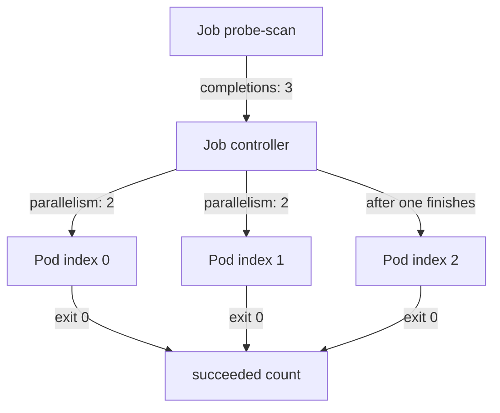

# Completions, Parallelism And Failure Limits

A Deployment treats a Pod that exits as a fault and starts another one. That is the wrong behavior for work that has an end, such as processing a file, running a database migration or scanning a data slice. This kind of work must run, finish, and then be left alone. A Job (the `batch/v1` resource for finite work) provides this. It creates Pods, counts how many finished successfully and stops when the count reaches a target.

This chapter shows which component does each step, how the numeric fields change the number of Pods, how Indexed mode gives each Pod its own slice of work, and which fields stop a Job that fails or hangs.

## The Job controller creates the Pods

You write a Job. The API server stores it. The Job controller, which runs inside `kube-controller-manager`, watches Jobs and creates Pods from the Job's Pod template. The scheduler then places each Pod on a node, and the kubelet on that node starts the containers. The Job controller never runs containers itself. It only creates Pods, counts their results and updates the Job status.

Two fields set the target. `spec.completions` is the number of Pods that must succeed. `spec.parallelism` is the largest number of Pods that may run at the same time. If `completions` is 3 and `parallelism` is 2, the controller creates two Pods, and creates the third when one of them finishes. If you omit both fields, each defaults to 1, so the Job runs one Pod once.



The diagram shows that the controller starts two Pods first, starts the third after one ends, and counts each Pod that exits with status 0.

## Indexed completion mode

By default (`completionMode: NonIndexed`) every Pod is identical and the Pods have no order. That works when each Pod takes work from a queue. It does not work when each Pod must process a known slice. With `completionMode: Indexed` the Job controller gives each Pod a number from 0 to `completions - 1`. The number is unique among the Pods that are running or have succeeded. When a Pod for index 1 fails, the replacement Pod gets index 1 again.

The Pod learns its number in three ways: the environment variable `JOB_COMPLETION_INDEX` that the controller adds to every container, the annotation `batch.kubernetes.io/job-completion-index` and the label of the same name. The Pod name also contains the index.

Save this as `probe-scan.yaml`:

```yaml
apiVersion: batch/v1
kind: Job
metadata:
  name: probe-scan
  namespace: starfleet
spec:
  completions: 3
  parallelism: 2
  completionMode: Indexed
  template:
    spec:
      restartPolicy: Never
      containers:
      - name: scan
        image: docker.io/library/busybox:1.37.0
        command: ["sh", "-c", "echo scanned slice $JOB_COMPLETION_INDEX; sleep 15"]
```

<!-- astrona:playground:renew -->
Apply it:

```sh
kubectl apply -f probe-scan.yaml
```

Then check the result. Run this within the first few seconds:

```sh
kubectl -n starfleet get pods -l job-name=probe-scan -L batch.kubernetes.io/job-completion-index
```

Two Pods exist, with indexes 0 and 1. The third waits because `parallelism` is 2. After about fifteen seconds one of them finishes and the controller creates index 2. When all three have succeeded, read the Job:

```sh
kubectl -n starfleet get job probe-scan -o jsonpath='{.status.succeeded} {.status.completedIndexes}{"\n"}'
kubectl -n starfleet logs -l job-name=probe-scan --tail=1
```

The status shows `3` succeeded and `0-2` as the completed indexes. Each log line names one slice, so each index ran exactly once. The Job status keeps these counters because the Job controller counts Pods that finish, even after the Pods are deleted.

## Failures, backoffLimit and restartPolicy

Real work fails. The Job controller needs a rule for how many times to try again. `spec.backoffLimit` is that rule. The controller counts Pod failures, waits between retries (the delay starts at 10 seconds and doubles each time, up to 6 minutes) and marks the Job as failed when the failures exceed `backoffLimit`. The default is 6.

`restartPolicy` decides who does the retry. A Job Pod template must use `Never` or `OnFailure`; `Always` is rejected. With `Never`, a failed container ends the Pod, and the Job controller creates a new Pod. You keep every failed Pod and its logs. With `OnFailure`, the kubelet restarts the container inside the same Pod, so there is one Pod with a growing restart count and the logs of earlier runs are harder to reach. Both choices count toward `backoffLimit`.

Save this as `probe-fail.yaml`:

```yaml
apiVersion: batch/v1
kind: Job
metadata:
  name: probe-fail
  namespace: starfleet
spec:
  backoffLimit: 2
  template:
    spec:
      restartPolicy: Never
      containers:
      - name: scan
        image: docker.io/library/busybox:1.37.0
        command: ["sh", "-c", "echo bad slice; exit 1"]
```

Apply it:

```sh
kubectl apply -f probe-fail.yaml
```

Then check the result after about a minute:

```sh
kubectl -n starfleet get pods -l job-name=probe-fail
kubectl -n starfleet get job probe-fail -o jsonpath='{range .status.conditions[*]}{.type}={.status} {.reason}{"\n"}{end}'
```

Three Pods in the `Error` state exist: the first try and two retries. The Job has a `Failed` condition with the reason `BackoffLimitExceeded`. The controller stops creating Pods after that.

The single `backoffLimit` counter covers the whole Job. In Indexed mode you can count per index instead with `backoffLimitPerIndex`, which is stable in Kubernetes 1.35 and needs `completionMode: Indexed` and `restartPolicy: Never`. A failing index then stops retrying without stopping the other indexes, and `maxFailedIndexes` sets how many failed indexes the Job tolerates before it stops everything. The Job still ends as failed when any index failed.

## Deadlines and cleanup

A Job whose Pod hangs never fails by retries, because nothing exits. `spec.activeDeadlineSeconds` limits the total run time of the Job. When the time passes, the controller deletes the running Pods and marks the Job failed with the reason `DeadlineExceeded`. The deadline applies to the whole Job and takes priority over `backoffLimit`.

A finished Job stays in the API until someone deletes it. Many Jobs fill the API with objects. `spec.ttlSecondsAfterFinished` asks the TTL controller (time to live controller) to delete the Job and its Pods that many seconds after the Job completes or fails. The value `0` deletes it at once. If the field is unset, nothing deletes the Job.

Save this as `probe-sleep.yaml`:

```yaml
apiVersion: batch/v1
kind: Job
metadata:
  name: probe-sleep
  namespace: starfleet
spec:
  activeDeadlineSeconds: 20
  ttlSecondsAfterFinished: 60
  template:
    spec:
      restartPolicy: Never
      containers:
      - name: scan
        image: docker.io/library/busybox:1.37.0
        command: ["sh", "-c", "sleep 300"]
```

Apply it:

```sh
kubectl apply -f probe-sleep.yaml
```

Then check the result after about thirty seconds:

```sh
kubectl -n starfleet get job probe-sleep -o jsonpath='{range .status.conditions[*]}{.type}={.status} {.reason}{"\n"}{end}'
```

The Job is `Failed` with the reason `DeadlineExceeded`, and its Pod is gone. About a minute later the TTL controller deletes the Job object, and `kubectl -n starfleet get job probe-sleep` reports `NotFound`.

A Job guarantees that the target count of Pods succeeded, not that each unit of work ran only once. A Pod can finish its work and then be lost before the controller counts it, so the work must be safe to repeat. You now know how a Job creates, numbers, limits and removes its Pods. The open question is how to start a Job on a clock without doing it by hand.

## Common pitfalls

> [!WARNING]
> - The Pod template and `completionMode` of a Job cannot be changed after creation, and `completions` can change only in a narrow case. To change them, delete the Job and create it again.
> - `restartPolicy: Always` is rejected in a Job. Use `Never` or `OnFailure`.
> - `backoffLimit: 2` allows three Pods in total: one first try and two retries.
> - `activeDeadlineSeconds` ends the whole Job, including Pods that still work, even when the failure count is low.
> - Without `ttlSecondsAfterFinished`, finished Jobs and their Pods stay until you delete them.
> - `parallelism` is a limit, not a promise. The controller never runs more Pods than `completions` still needs.
