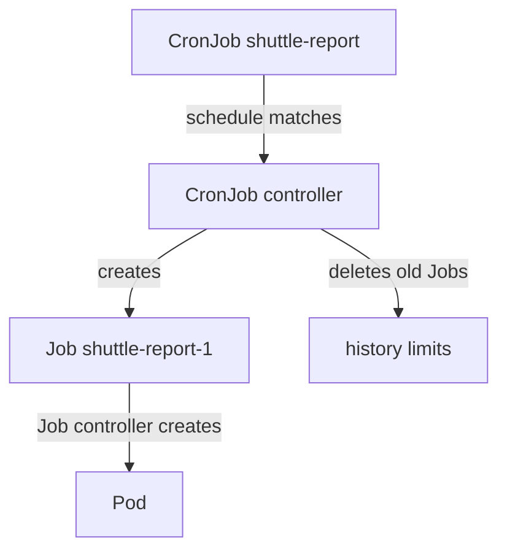

# CronJob Schedules And History Policies

Finite work often has to repeat: a report every morning, a cleanup every night, a health sweep every ten minutes. Starting a Job by hand each time does not scale, and a person forgets. A CronJob (the `batch/v1` resource for scheduled work) creates a new Job on a schedule, so the repeat is part of the cluster configuration.

A schedule raises questions that a single Job never has. What happens when the previous run is still going at the next tick? What happens when the controller was down at the tick? Which clock does the schedule use, and how many old Jobs stay in the API? Each question has a field with a documented default. This chapter shows the mechanism first, then each field.

## The CronJob controller creates Jobs

A CronJob does not create Pods. The CronJob controller, which runs inside `kube-controller-manager`, reads the schedule, and at each matching time it creates a Job from `spec.jobTemplate`. From that point the Job controller and the kubelet do the same work as for any Job. The new Job has an owner reference to the CronJob, so deleting the CronJob deletes its Jobs.



The diagram shows that the CronJob controller creates only Jobs and prunes old ones, and the Job controller creates the Pods.

The schedule has five fields: minute, hour, day of month, month and day of week. `*/5 * * * *` means every five minutes, and `0 6 * * *` means 06:00 each day. The macros `@hourly`, `@daily`, `@weekly`, `@monthly` and `@yearly` also work. By default the controller reads the schedule in the time zone of `kube-controller-manager`, which is usually UTC. The field `spec.timeZone`, stable since Kubernetes 1.27, takes an IANA time zone name such as `Europe/Copenhagen`. The schedule then follows that zone, including changes between summer and winter time. Do not put `TZ=` or `CRON_TZ=` in the schedule string.

## Overlap, deadlines and history

Three fields decide what happens when runs collide or are missed. `concurrencyPolicy` governs overlap between Jobs of the same CronJob: `Allow` (the default) starts the new Job anyway, `Forbid` skips the new run while a previous Job is still active, and `Replace` deletes the running Job and starts a new one. Skipped runs are not made up later.

`startingDeadlineSeconds` is the number of seconds after the scheduled time in which the Job may still start. If the controller cannot start it in that window, for example because it was down, it counts the run as missed and skips it. When the field is unset there is no deadline, but the controller stops scheduling the CronJob if it counts more than 100 missed runs since the last successful schedule. A deadline limits that count to the window.

`successfulJobsHistoryLimit` (default 3) and `failedJobsHistoryLimit` (default 1) tell the controller how many finished Jobs to keep. A value of `0` keeps none. A Job that is kept still has its Pods and logs, which is how you find out why a scheduled run failed.

Save this as `cronjob-shuttle-report.yaml`:

```yaml
apiVersion: batch/v1
kind: CronJob
metadata:
  name: shuttle-report
  namespace: starfleet
spec:
  schedule: "*/1 * * * *"
  timeZone: "Europe/Copenhagen"
  concurrencyPolicy: Forbid
  startingDeadlineSeconds: 60
  successfulJobsHistoryLimit: 2
  failedJobsHistoryLimit: 1
  jobTemplate:
    spec:
      ttlSecondsAfterFinished: 600
      template:
        spec:
          restartPolicy: OnFailure
          containers:
          - name: report
            image: docker.io/library/busybox:1.37.0
            command: ["sh", "-c", "date; sleep 90"]
```

<!-- astrona:playground:renew -->
Apply it:

```sh
kubectl apply -f cronjob-shuttle-report.yaml
```

The Job sleeps for 90 seconds, which is longer than the one-minute schedule. Wait about four minutes, then check the result:

```sh
kubectl -n starfleet get cronjob shuttle-report
kubectl -n starfleet get jobs
kubectl -n starfleet get events --field-selector reason=JobAlreadyActive
```

The CronJob lists its schedule, `SUSPEND` as `False` and the count of active Jobs. The Job list shows a Job about every two minutes, not every minute, because `Forbid` made the controller skip each tick that arrived while the previous Job was still running. The events show the reason `JobAlreadyActive` for the skipped ticks. Finished Jobs never exceed two successful ones, because the history limit makes the controller delete the oldest.

## Suspend and manual runs

Sometimes a scheduled task must stop for a while, for example during maintenance, without losing its definition. Setting `spec.suspend: true` makes the CronJob controller create no new Jobs. Jobs that already run are not affected. The schedule and history stay in place, and setting `suspend` back to `false` resumes the clock.

Save this as `suspend-patch.yaml`:

```yaml
spec:
  suspend: true
```

Apply it with a patch:

```sh
kubectl -n starfleet patch cronjob shuttle-report --patch-file suspend-patch.yaml
```

Then check the result:

```sh
kubectl -n starfleet get cronjob shuttle-report -o jsonpath='{.spec.suspend}{"\n"}'
```

The output is `true`. No further Job appears at the next minute.

A suspended CronJob is still a template you can run once. `kubectl create job --from=cronjob/<name>` copies the CronJob's `jobTemplate` into a new Job and creates it at once. This is how you test a scheduled task without waiting for the clock. Run it against the `outpost-sweep` CronJob:

```sh
kubectl -n outpost create job sweep-now --from=cronjob/outpost-sweep
kubectl -n outpost get job sweep-now -o jsonpath='{.metadata.annotations}{"\n"}'
```

The new Job carries the annotation `cronjob.kubernetes.io/instantiate: manual`. It runs through the Job controller like any Job. The CronJob's concurrency policy does not apply to it, because the CronJob controller did not create it.

You now know how a CronJob turns a template and a schedule into Jobs, and how its fields handle overlap, missed runs and history. Names matter too: the controller appends 11 characters to the CronJob name to build the Job name, so a CronJob name must not exceed 52 characters. What remains open is how a whole workload design chooses between a Job, a CronJob and the long-running controllers.

## Common pitfalls

> [!WARNING]
> - `concurrencyPolicy` defaults to `Allow`. A slow Job then overlaps with the next one, and runs pile up.
> - A skipped run under `Forbid` is lost. It is not run later.
> - Without `startingDeadlineSeconds`, more than 100 missed runs make the CronJob controller stop scheduling it.
> - Without `spec.timeZone`, the schedule uses the time zone of the controller, not the time zone of your team.
> - A CronJob name over 52 characters is rejected, because the Job name needs 11 more characters.
> - `suspend: true` does not stop a Job that already runs. Delete that Job to stop it.
