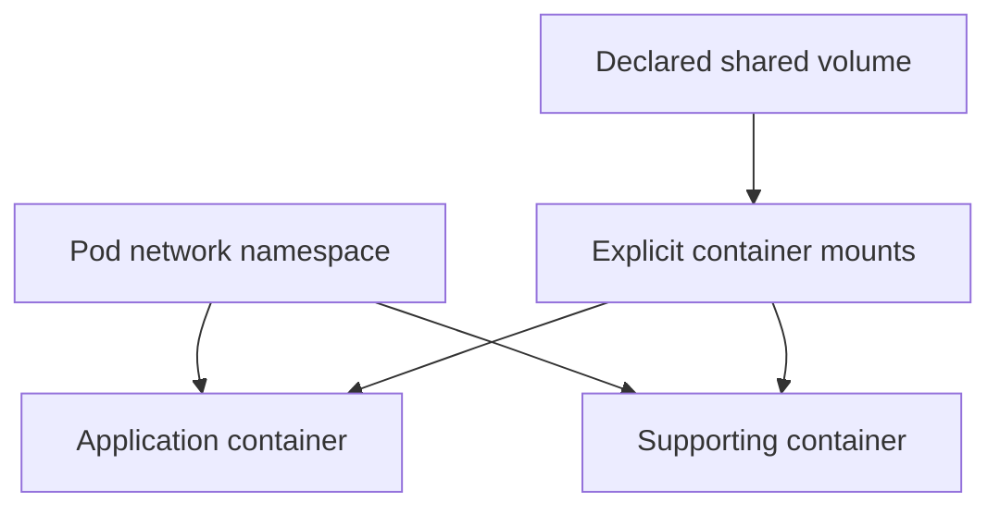

# Sharing Pod Resources Without Sharing Every Assumption

Two containers can reach the same Pod-local listener while failing to see each other's files. Pod networking is shared, but image filesystems remain separate. File exchange needs a volume mounted into both containers.

## Learning objectives

- Distinguish shared network identity from separate container filesystems.
- Explain volume lifetime during container restart and Pod replacement.
- Evaluate readiness and resource requirements for supporting containers.

## Before you start

Use a shell on your own machine with the module playground running. A Pod is Kubernetes's unit for running one or more containers together. The environment provides the `probe` Deployment, which maintains application Pods, and the `starfleet` namespace, which groups these objects.

Read-only commands below use kubectl, the Kubernetes command-line tool. Select the private kubeconfig: the file that identifies this environment's cluster and credentials. The commands do not change the application.

## Sharing Pod Resources Without Sharing Every Assumption

A multi-container Pod groups containers that need a shared scheduling and lifecycle context. Its containers run on the same node, use the Pod network and can mount declared volumes. Grouping unrelated services into one Pod merely because they communicate makes their placement and replacement dependent without necessarily providing a useful design benefit.

## Shared Network, Separate Processes

Containers in a normal Pod share its network namespace. They can reach each other's listening ports through `localhost`, and they share the Pod's address. They cannot independently bind the same port on the same address without compatible socket behavior. A `scout` server and a helper both trying to listen on port 8080 can therefore conflict even though they are different containers.

The shared network does not mean all filesystems are shared. Each container has its own image filesystem. A file written to one container's ordinary writable layer is not automatically visible to another. Both containers must mount an appropriate shared volume when file exchange is part of their contract.

Process visibility is also a separate setting. Merely sharing a Pod does not mean one container can inspect all other containers' processes. Pod process-namespace sharing changes that relationship when enabled. Additional permissions can still be necessary, and diagnostic visibility should not be confused with permission to alter another process.

## Initialization And Continued Assistance

A regular init container runs before ordinary application containers and must finish successfully before startup proceeds. It is useful for bounded preparation, such as checking a required file format or writing initial configuration into a shared volume. An init container that waits forever for a dependency can prevent the whole application from starting.

A sidecar provides a continuing supporting function. A log-forwarding helper can read files from a shared volume while the application writes them. A proxy can handle transport beside the application. Native sidecars are represented as restartable init containers using `restartPolicy: Always`, with lifecycle behavior different from an ordinary init task that must terminate.

An adapter changes the representation of data or a protocol for another consumer. An ambassador handles communication with an external service on behalf of the application. These are design descriptions, not Kubernetes resource kinds. The actual Pod specification, mounts, commands and lifecycle settings determine whether the intended pattern works.

## Coordinate Readiness And Shutdown

A helper can be running while the application is unready, and an application can be responsive while an essential helper is failing. A readiness check should represent whether the workload can fulfill the requests that will reach it. Adding a sidecar does not automatically make its failure affect every application health decision appropriately.

Shutdown also requires a contract. A writer may need to flush pending work before a log collector exits. A proxy may need to remain available while the application finishes requests. Native sidecar shutdown ordering can support such relationships, but the application still needs suitable signals, time limits and safe behavior when infrastructure fails abruptly.

A shared volume's lifetime can differ from either container's process lifetime. An `emptyDir` volume normally survives container restarts within the same Pod but disappears when that Pod is removed. A helper that treats the shared directory as permanent storage will lose data after replacement even if simple restart tests appeared successful.

## Decide Whether The Grouping Fits

If two services need independent scaling, deployment and failure recovery, separate workloads often provide a clearer design. If a helper must accompany each application replica and use local shared state, one Pod can express that dependency. Consider resource use as well: a helper's requests contribute to scheduling requirements, and an excessive limit can affect the workload's operation.

Read each container's image, startup command, mounts and health behavior individually. Then examine the shared network and storage contract. That two-level review explains why a Pod can exist successfully while one container is unable to read a file or serve its expected role.

## Inspect the mechanism

A Pod gives its containers one network namespace: the network context that holds addresses and ports. A listener on one port is therefore shared across that context; two containers cannot independently bind the same address and port without an appropriate design. This is different from a shared filesystem.

The fixture mounts `probe-code` into the application container at `/app`. A second container would need its own volume mount to see that same supplied data. Similarly, file exchange through `emptyDir` requires both containers to mount the named volume. An `emptyDir` lasts for the Pod's lifetime, so a container restart can preserve it while Pod replacement removes it.



Network sharing is a Pod property, while file sharing requires explicit mounts in each container.

<!-- astrona:playground:renew -->

Select the private cluster connection and inspect the live state from your host shell:

```sh
export KUBECONFIG="$(astrona kubeconfig ats-027-playground-030-01)"
if test "$(kubectl config current-context)" = "kind-astro-ats-027-playground-030-01"; then
  kubectl -n starfleet get deployment probe -o jsonpath='{.spec.template.spec.volumes}{"\n"}{range .spec.template.spec.containers[*]}{.name}{" "}{.volumeMounts}{"\n"}{end}'
else
  printf "Select this module's private kubeconfig before continuing.\n" >&2
fi
```

Compare volume declarations with each container's mounts. A declaration alone does not attach the volume at a path inside every container. The baseline uses a ConfigMap volume rather than `emptyDir`; do not infer writable shared storage from the fact that `/app` is mounted. File access mode and each container's permissions remain part of the contract.

You can now describe which resources are shared and which remain container-specific. Keeping helpers in one Pod couples their placement and replacement, so independent scaling requirements may call for separate workloads.

## Common pitfalls

> [!WARNING]
> A shared Pod does not imply a shared image filesystem or identical lifecycle behavior. State explicitly which ports, volumes and startup or shutdown dependencies each container requires.
