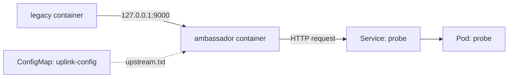

# Ambassador Proxy Over Localhost

Some applications cannot be told where their dependencies live. The code contains the address `127.0.0.1:9000`, and nobody can rebuild the image. In a Kubernetes cluster the dependency is a Service with a DNS (Domain Name System) name, and it is reachable only through the cluster network. The ambassador pattern closes this gap: a second container in the same Pod listens on the address the application expects and forwards each request to the real destination.

This part first shows the failure, then explains why a second container can answer on `localhost`, and then builds the ambassador with its settings in a ConfigMap.

## The failure in the playground

The playground contains the Pod `legacy-scout`. Its only container runs a shell loop that calls `http://127.0.0.1:9000/` with `wget` every five seconds and writes a `status` line to a report file. Nothing listens on that port, so the call fails. Read the logs of the container first and see what the application says.

<!-- astrona:playground:renew -->

```sh
kubectl -n starfleet logs legacy-scout --tail=3
```

The last lines read `legacy: uplink failed`. The report file holds `status=error` lines, and you can read them with `kubectl -n starfleet exec legacy-scout -- tail -n 4 /report/report.txt`. The application is not broken. It asks for a service on its own machine, and the machine does not have one.

## Why localhost works across containers

A Pod is the smallest unit that Kubernetes schedules. It holds one or more containers that always run on the same node. The kubelet (the agent on each node) asks the container runtime to create a network namespace for the Pod. A network namespace is a Linux feature that gives a group of processes their own network interfaces, IP addresses and ports. All containers of the Pod join this one namespace.

The result is that every container in the Pod has the same IP address and the same `127.0.0.1`. If one container listens on `127.0.0.1:9000`, another container in the Pod reaches it with a plain `localhost` connection. No Service, DNS name or network policy is involved, because the traffic never leaves the Pod. The side effect is that two containers cannot listen on the same port in one Pod.

This is the technical basis of the ambassador pattern. The ambassador is a container that owns the loopback port the application expects. It receives the request on `localhost` and opens a new connection to the real destination, here the Service `probe`.



The diagram shows two containers in one Pod sharing the loopback interface. The ambassador reads the destination from a file that comes from a ConfigMap, and the Service sends the request on to a `probe` Pod.

## Putting the destination in a ConfigMap

A ConfigMap is an API object that stores small pieces of configuration as key-value pairs. When a Pod mounts a ConfigMap as a volume, the kubelet writes each key as a file in the mount directory. The ambassador code in `ambassador-code` reads the file `/etc/ambassador/upstream.txt` on every request. The destination therefore lives in the ConfigMap, not in the image and not in the Pod spec.

Save this as `configmap-uplink.yaml`:

```yaml
apiVersion: v1
kind: ConfigMap
metadata:
  name: uplink-config
  namespace: starfleet
data:
  upstream.txt: "http://probe.starfleet.svc.cluster.local"
```

Apply it:

```sh
kubectl apply -f configmap-uplink.yaml
```

The file holds the full address of the `probe` Service: the Service name, the namespace and the cluster domain. Port 80 is the default for HTTP, so it does not appear.

## The Pod with the ambassador

Pod containers cannot be added to a running Pod, so the new Pod is a separate object with two containers. The `legacy` container is the same loop as before. The `ambassador` container uses the `python:3.13-alpine` image and runs `proxy.py` from the ConfigMap `ambassador-code`. The `report` volume is an `emptyDir`, a directory that Kubernetes creates empty when the Pod starts and removes when the Pod ends.

Save this as `pod-scout-ambassador.yaml`:

```yaml
apiVersion: v1
kind: Pod
metadata:
  name: scout-ambassador
  namespace: starfleet
spec:
  containers:
    - name: legacy
      image: docker.io/library/busybox:1.37.0
      command: ["sh", "-c"]
      args:
        - |
          while true; do
            echo "time=$(date +%s)" >> /report/report.txt
            if reply="$(wget -q -T 2 -O - http://127.0.0.1:9000/ 2>/dev/null)"; then
              echo "status=ok" >> /report/report.txt
              echo "reply=$reply" >> /report/report.txt
              echo "legacy: uplink ok"
            else
              echo "status=error" >> /report/report.txt
              echo "legacy: uplink failed"
            fi
            sleep 5
          done
      volumeMounts:
        - name: report
          mountPath: /report
    - name: ambassador
      image: docker.io/library/python:3.13-alpine
      command: ["python", "/code/proxy.py"]
      volumeMounts:
        - name: code
          mountPath: /code
          readOnly: true
        - name: uplink
          mountPath: /etc/ambassador
          readOnly: true
  volumes:
    - name: report
      emptyDir: {}
    - name: code
      configMap:
        name: ambassador-code
    - name: uplink
      configMap:
        name: uplink-config
```

Apply it:

```sh
kubectl apply -f pod-scout-ambassador.yaml
```

Then check the result. The scheduler picks a node, the kubelet starts both containers, and the application succeeds on its next call. Wait until the Pod is ready, then read the application logs:

```sh
kubectl -n starfleet wait --for=condition=Ready pod/scout-ambassador --timeout=120s
kubectl -n starfleet logs scout-ambassador -c legacy --tail=3
```

The logs now read `legacy: uplink ok`. One early line may still say `legacy: uplink failed`, because both containers start at about the same time and the application can call before the proxy listens. Ordinary containers of a Pod start in no guaranteed order, so the application cannot rely on the proxy being ready first.

## Proving that the traffic crosses containers

Ask the proxy directly from the `legacy` container, which has no Python and no extra tools:

```sh
kubectl -n starfleet exec scout-ambassador -c legacy -- wget -q -O - http://127.0.0.1:9000/
```

The answer is `probe-nominal`. The request left the `legacy` container, reached the `ambassador` process through the shared loopback interface, went to the `probe` Service through the cluster network and came back. The application never learned the Service name.

## When the destination changes

Because the destination is a file from a ConfigMap, the operator can move the ambassador to another backend without changing the image or the Pod spec. The kubelet watches the ConfigMap and updates the mounted file on a periodic sync, so the change can take up to about a minute. The proxy reads the file again on every request, so it needs no restart. A proxy that reads its settings only at startup would need a restart to see the change. A ConfigMap mounted with `subPath` never updates at all.

The ambassador is also the right place for logic the application cannot have: retries, a timeout, a connection to a sharded database, or a token added to each request. The application keeps talking to `localhost`. Only the ambassador knows about the cluster.

This part showed that the ambassador works because containers of one Pod share a network namespace, and that the destination can live in a ConfigMap. The open question is how a container passes data out of the Pod in a form that other tools accept.

## Common pitfalls

> [!WARNING]
> - The ambassador must listen on `127.0.0.1` or `0.0.0.0` on the port the application uses. A different port does nothing, because the application never calls it.
> - Two containers in one Pod cannot use the same port. A port conflict makes the second container fail to start.
> - A ConfigMap mounted with `subPath` does not receive updates. Mount the whole ConfigMap as a directory if the file must change at runtime.
> - A probe from the kubelet connects to the Pod IP address, not to loopback. A proxy that listens only on `127.0.0.1` cannot pass an HTTP or TCP probe from the kubelet; use an `exec` probe for it.
> - The ambassador is part of the Pod. If it crashes and restarts, the application sees failed connections for a moment, so the application still needs ordinary retry behaviour.
