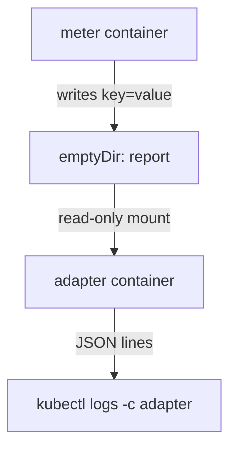

# Adapter Output Translation

An old application writes its status in a format that was fine for its first user: plain lines such as `reading=21`. A modern log collector or monitoring agent wants JSON (JavaScript Object Notation), one object per line. Changing the application is not possible or not wanted. The adapter pattern puts a second container in the Pod that reads what the main container produces and writes it in the format the consumer expects.

This part builds an adapter that follows a report file, converts each line to JSON and prints it to its own standard output. Then it compares the adapter with the ambassador, the sidecar and the init container, because the four patterns look similar in YAML and differ in purpose.

## How the two containers share data

Containers in a Pod have separate file systems. A file that the `meter` container writes is invisible to another container, unless both mount the same volume. An `emptyDir` volume is a directory on the node that the kubelet creates when the Pod starts and deletes when the Pod is removed. Both containers mount it, each at the path it needs, and both see the same files.

The main container needs read and write access. The adapter only reads, so its mount carries `readOnly: true`. The container runtime then mounts the directory read-only for that container, and any write fails with a "Read-only file system" error. This is a safety rule: a bug in the adapter cannot damage the data of the application.



The diagram shows one writer, one reader and the output of the reader, which the container runtime captures as the container log.

## The Pod with the adapter

The `meter` container appends two lines every five seconds: a timestamp reading and the unit. The `adapter` container runs `tail -F`, which follows the file and keeps waiting if it does not exist yet. A `while` loop passes each line to `sed`, and `sed` rewrites `key=value` into `{"key":"value"}`. The adapter handles the TERM signal with a `trap` so it exits at once when Kubernetes stops the Pod.

<!-- astrona:playground:renew -->

Save this as `pod-meter-adapter.yaml`:

```yaml
apiVersion: v1
kind: Pod
metadata:
  name: meter-adapter
  namespace: starfleet
spec:
  containers:
    - name: meter
      image: docker.io/library/busybox:1.37.0
      command: ["sh", "-c"]
      args:
        - |
          while true; do
            echo "reading=$(date +%s)" >> /report/report.txt
            echo "unit=seconds" >> /report/report.txt
            sleep 5
          done
      volumeMounts:
        - name: report
          mountPath: /report
    - name: adapter
      image: docker.io/library/busybox:1.37.0
      command: ["sh", "-c"]
      args:
        - |
          trap 'exit 0' TERM
          tail -n +1 -F /report/report.txt | while IFS= read -r line; do
            echo "$line" | sed 's/^\([^=]*\)=\(.*\)$/{"\1":"\2"}/'
          done &
          wait $!
      volumeMounts:
        - name: report
          mountPath: /report
          readOnly: true
  volumes:
    - name: report
      emptyDir: {}
```

Apply it:

```sh
kubectl apply -f pod-meter-adapter.yaml
```

Then check the result. Wait for the Pod and read the two logs side by side. The `meter` container prints nothing, because it writes only to the file. The `adapter` container prints the converted lines:

```sh
kubectl -n starfleet wait --for=condition=Ready pod/meter-adapter --timeout=120s
kubectl -n starfleet logs meter-adapter -c adapter --tail=4
```

Each line is a JSON object such as `{"unit":"seconds"}`. The file itself did not change. Read it from the `meter` container to confirm that the original format is still there:

```sh
kubectl -n starfleet exec meter-adapter -c meter -- tail -n 4 /report/report.txt
```

## The read-only mount in practice

Try to write to the report from the adapter container. The command must fail, and the file must stay as it was:

```sh
kubectl -n starfleet exec meter-adapter -c adapter -- sh -c 'echo x >> /report/report.txt'
```

The shell reports that it cannot create the file because the file system is read-only, and `kubectl` returns a non-zero exit status. The volume is the same directory for both containers. Only the mount flag differs. The kubelet and the container runtime enforce the flag, not the application.

## Ambassador, adapter, sidecar and init container

All four patterns put more than one container in a Pod. They differ in the direction of the data and in the time each container runs.

| Pattern | Purpose | Direction | When it runs |
| --- | --- | --- | --- |
| Ambassador | Represents a remote service to the application | The application calls it, on `localhost` | Next to the application for its whole life |
| Adapter | Converts the output of the application | It reads what the application wrote, through a shared volume or a local port | Next to the application for its whole life |
| Sidecar | Adds a general capability, such as log shipping, a proxy or a refresher | Either direction | Next to the application for its whole life |
| Init container | Prepares something once | Writes files or checks a condition | Before the application, then it exits |

The ambassador and the adapter are named kinds of sidecar. The sidecar is the general idea of a helper container that runs beside the application. The ambassador is the helper for outgoing calls and the adapter is the helper for outgoing data. An init container is different: it must finish before the application starts and it never runs again, so it cannot translate output that does not exist yet.

The adapter has a limit. It converts data after the application has written it, so there is always a small delay. It also adds a container to every replica, which costs memory and CPU for each one. If many Pods need the same conversion, a node-level agent can be cheaper than an adapter in every Pod.

You now have two helper containers that serve one application. They run as ordinary containers, so the Pod gives no guarantee about which one starts first or when it stops. The question that remains is how to control that order.

## Common pitfalls

> [!WARNING]
> - Do not mount the shared volume read-write in the adapter unless it must write. A read-only mount protects the data of the main container.
> - `tail -F` (capital F) follows a file by name and survives a missing file. `tail -f` fails when the file does not exist yet, and the adapter crashes if it starts before the application writes.
> - An `emptyDir` is removed when the Pod is deleted. Data that must survive a Pod restart on another node needs a persistent volume.
> - Without a `trap`, a shell running as the main process of a container ignores the TERM signal, and Kubernetes waits for the full grace period before it kills the adapter.
> - A growing report file fills the node disk. The application or another process must rotate it, because the adapter only reads.
