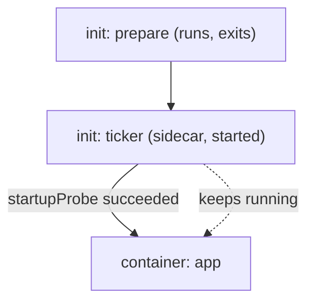

# Restartable Init Containers

A Pod needs a helper that must be running before the application starts, and must keep running while the application works. A plain init container cannot do this, because it must exit before the next container starts. An ordinary container cannot do it either, because the kubelet starts ordinary containers without an order. A restartable init container, also called a native sidecar, does both.

This part defines the field that makes an init container a sidecar, follows a Pod through startup, shows what the `startupProbe` and the `readinessProbe` of a sidecar control, and explains how the scheduler counts the resources of such a Pod.

## What `restartPolicy: Always` changes

An init container is a container in `spec.initContainers`. The kubelet, the agent on each node, runs the init containers one at a time in the order of the list. Each one must exit successfully before the next one starts. When the last one has finished, the kubelet starts the containers in `spec.containers`.

A native sidecar is an init container that has `restartPolicy: Always`. The feature has been stable since Kubernetes 1.33 and is on by default. The field changes three things. The kubelet does not wait for the container to exit. It considers the sidecar ready to continue once the container has started, and then it starts the next init container. The sidecar keeps running for the life of the Pod, and the kubelet restarts it whenever it exits. Finally, the sidecar supports `startupProbe`, `readinessProbe`, `livenessProbe` and `lifecycle` hooks, which an ordinary init container does not.

A container is "started" in the sense of the kubelet when its process runs and no `startupProbe` is defined, or when its `startupProbe` has succeeded once. The kubelet records this in the field `started` of the init container status.



The diagram shows the order. `prepare` must exit, then `ticker` starts and must become started, and only then does `app` start. `ticker` keeps running next to `app`.

## A Pod with an init container and a sidecar

The Pod below has an ordinary init container `prepare`, a sidecar `ticker` and an application `app`. The three containers share an `emptyDir` volume and record when they start in the file `order.log`. The `ticker` waits ten seconds before it creates the file `ticker-ready`. Its `startupProbe` runs `test -f /shared/ticker-ready` every two seconds, so the sidecar counts as started only after ten seconds. Its `readinessProbe` runs the same test.

<!-- astrona:playground:renew -->

Save this as `pod-sidecar-order.yaml`:

```yaml
apiVersion: v1
kind: Pod
metadata:
  name: sidecar-order
  namespace: starfleet
spec:
  terminationGracePeriodSeconds: 5
  initContainers:
    - name: prepare
      image: docker.io/library/busybox:1.37.0
      command: ["sh", "-c", "echo 'prepare: done' >> /shared/order.log"]
      volumeMounts:
        - name: shared
          mountPath: /shared
    - name: ticker
      image: docker.io/library/busybox:1.37.0
      restartPolicy: Always
      command: ["sh", "-c"]
      args:
        - |
          trap 'exit 0' TERM
          echo 'ticker: process started' | tee -a /shared/order.log
          sleep 10
          touch /shared/ticker-ready
          echo 'ticker: ready' | tee -a /shared/order.log
          while true; do sleep 1; done
      startupProbe:
        exec:
          command: ["test", "-f", "/shared/ticker-ready"]
        periodSeconds: 2
        failureThreshold: 15
      readinessProbe:
        exec:
          command: ["test", "-f", "/shared/ticker-ready"]
        periodSeconds: 2
        failureThreshold: 1
      volumeMounts:
        - name: shared
          mountPath: /shared
  containers:
    - name: app
      image: docker.io/library/busybox:1.37.0
      command: ["sh", "-c", "echo 'app: started' >> /shared/order.log; sleep 3600"]
      volumeMounts:
        - name: shared
          mountPath: /shared
  volumes:
    - name: shared
      emptyDir: {}
```

Apply it:

```sh
kubectl apply -f pod-sidecar-order.yaml
```

Then check the result. While the sidecar waits for its probe, the Pod shows an init status and `app` does not exist yet. Wait for the Pod and read the order file:

```sh
kubectl -n starfleet wait --for=condition=Ready pod/sidecar-order --timeout=120s
kubectl -n starfleet exec sidecar-order -c app -- cat /shared/order.log
```

The file has four lines in this order: `prepare: done`, `ticker: process started`, `ticker: ready` and `app: started`. The application started only after the sidecar was ready, about ten seconds after the sidecar process began. The kubelet enforced this order. The containers did not coordinate with each other.

## Status and kubectl behaviour

The kubelet reports sidecars in `status.initContainerStatuses`, not in `status.containerStatuses`. Read the started and ready flags:

```sh
kubectl -n starfleet get pod sidecar-order -o jsonpath='{range .status.initContainerStatuses[*]}{.name}{" started="}{.started}{" ready="}{.ready}{"\n"}{end}'
```

`prepare` has `ready=true` because it has completed, and `ticker` has `started=true` and `ready=true`. The command `kubectl logs sidecar-order -c ticker` works for init containers and sidecars, because a log request names a container, not a list. The `kubectl exec` command also works on a running sidecar.

## How readiness reaches the Pod

The Pod is ready when every application container is ready and every sidecar that has a `readinessProbe` is ready. A Service sends traffic only to ready Pods, so a failing sidecar removes the whole Pod from its Service endpoints. Remove the marker file and check the Pod condition:

```sh
kubectl -n starfleet exec sidecar-order -c ticker -- rm /shared/ticker-ready
kubectl -n starfleet get pod sidecar-order -o jsonpath='{.status.conditions[?(@.type=="Ready")].status}'
```

The answer is `False` after a few seconds. Run the second command again until it changes. The `app` container is still running and ready, and the sidecar alone made the Pod not ready. Restore it with `kubectl -n starfleet exec sidecar-order -c ticker -- touch /shared/ticker-ready`, and the status returns to `True`.

## Resource accounting

The scheduler places a Pod on a node by its effective request for each resource. The effective request is the higher of two numbers: the sum of the requests of all sidecars and application containers, and the highest request of any single init container. Sidecars are in the sum, because they run for the whole life of the Pod. Ordinary init containers are not, because they run one after another and are gone before the application starts.

A worked example: `prepare` requests 200m CPU (two tenths of one core), `ticker` requests 50m and `app` requests 100m. The running containers need 50m plus 100m, which is 150m. The init container needs 200m. The effective request is 200m, so the node must have 200m free, although the Pod uses only 150m after startup. Limits and quota follow the same effective numbers.

This part showed that `restartPolicy: Always` turns an init container into an ordered, restartable helper, that `startupProbe` gates the next container and that `readinessProbe` joins the readiness of the Pod. It did not yet say what happens when the Pod stops, or what a sidecar does to a Job.

## Common pitfalls

> [!WARNING]
> - `restartPolicy: Always` belongs on an init container. Setting it on a container in `spec.containers` is not the sidecar feature.
> - A sidecar without a `startupProbe` counts as started when its process runs, not when it can serve. The application can start before the sidecar is usable.
> - A `startupProbe` that never succeeds keeps the Pod in an init state. The kubelet restarts the sidecar after the failure threshold, and `app` never starts.
> - A `readinessProbe` on a sidecar controls the readiness of the whole Pod. A sidecar that checks a remote service can take every replica out of a Service at once.
> - Sidecars add to the sum of requests for the whole life of the Pod. An oversized sidecar request multiplies by the number of replicas.
