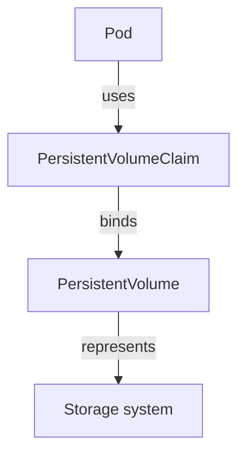
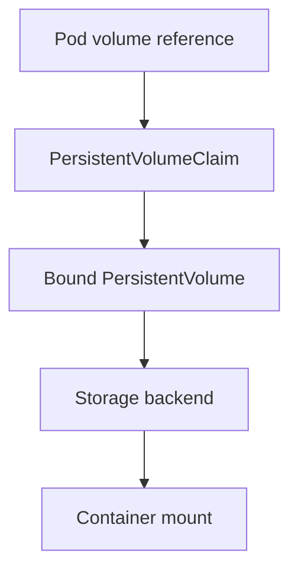

# Storage Lifecycles And Claims

A report saved inside one container disappears when that container is replaced. A file in `emptyDir` can survive a container restart but not Pod removal. A persistent claim supplies a different storage lifetime, subject to its backend and deletion policy.

## Learning objectives

- Compare image writes, emptyDir and persistent claim lifetimes.
- Trace a claim reference into a Pod volume mount.
- Explain why persistence does not establish backup or availability.

## Before you start

Use a shell on your own machine with the module playground running. A Pod is Kubernetes's unit for running one or more containers together. The environment provides the `probe` Deployment, which maintains application Pods, and the `starfleet` namespace, which groups these objects.

Read-only commands below use kubectl, the Kubernetes command-line tool. Select the private kubeconfig: the file that identifies this environment's cluster and credentials. The commands do not change the application.

## Storage Lifecycles and Claims

The `probe` application caches temporary files and stores durable reports. These two data classes need different lifecycles. A container's writable layer is tied to container execution and is unsuitable for important retained data. A volume exposes storage to containers through a mount and can have a different lifecycle.

An `emptyDir` volume exists for a Pod's lifetime. Containers can share it, and data can survive a container restart within that Pod. Deleting the Pod removes that temporary volume. A replacement Pod does not inherit it simply because the workload uses the same application name.

A PersistentVolume (PV) represents provisioned storage in the cluster. A PersistentVolumeClaim (PVC) is a namespaced request for storage with requirements such as capacity and access mode. A Pod references the claim, which binds to a suitable volume. This separates an application's request from the infrastructure-specific storage details.


The Pod requests access through a claim, while the volume represents the provisioned storage.

Persistence means data can outlive a Pod according to the storage lifecycle. It does not prove that storage is replicated, backed up or accessible from every node. A local volume and a remote replicated service have different failure properties despite both being persistent.

For a scenario, first ask what must survive: a process restart, Pod replacement, node loss or a regional outage. An `emptyDir` can satisfy the first case but not all the others. Then examine the provisioned storage system and the application's data consistency requirements.

## Predicting What Survives Each Event

A temporary file in the container's writable layer belongs to that container execution environment. A file in an `emptyDir` belongs to the Pod's lifetime. A file on a suitable persistent volume can outlive the Pod through its claim and storage lifecycle. These three files may have identical names inside the process while behaving differently during failure.

For a container restart within the same Pod, the `emptyDir` can remain available. For Pod deletion, its data does not transfer to the replacement. For replacement using the same persistent claim, the data can be accessible again if the backend and mount requirements permit it. Node loss adds another question: whether that storage can be reached from the replacement's location.

A volume mount defines where the process sees data. Two containers share data only when they access the same underlying volume through appropriate mounts. One container's ordinary image directory does not become shared merely because the containers occupy one Pod.

## Claim Binding Is Not Data Protection

A PVC describes a request, including capacity, access mode and selected storage class where applicable. A bound PV represents the chosen storage resource. Binding establishes an association; it does not independently prove that the application can write consistent records, that the backend is replicated or that a backup exists.

The claim is namespaced while the volume resource is cluster-scoped. This separates application ownership from infrastructure representation. A Pod normally uses a claim in its relevant namespace rather than freely selecting arbitrary volumes as though all storage were one global directory.

Choose storage by loss tolerance and access needs. Temporary caches can use ephemeral storage when rebuilding is acceptable. Reports requiring retention need a suitable persistent or external data service and a recovery plan. A persistence choice should explain exactly which events the data survives and which still require backup or manual restoration.

## Inspect the mechanism

A PersistentVolumeClaim (PVC) is a namespaced request for storage. A PersistentVolume (PV) represents available storage for binding. The Pod refers to its claim, and the kubelet arranges the supported volume for the container's mount. A claim existing in the API does not prove it has bound or that its storage can be mounted on the selected node.

The fixture's mounted application code comes from a ConfigMap, not a persistent claim. Distinguishing that starting volume type prevents a restart experiment from being interpreted as a durability guarantee. Persistent means the storage can have a lifetime separate from one Pod; it does not mean the backend has backups, replicated availability or protection against deleting the claim.



A mount depends on a chain of references, binding and backend access, rather than on the claim name alone.

<!-- astrona:playground:renew -->

Select the private cluster connection and inspect the live state from your host shell:

```sh
export KUBECONFIG="$(astrona kubeconfig ats-027-playground-040-01)"
if test "$(kubectl config current-context)" = "kind-astro-ats-027-playground-040-01"; then
  kubectl -n starfleet get deployment probe -o jsonpath='{.spec.template.spec.volumes}{"\n"}'
  kubectl -n starfleet get persistentvolumeclaims
  kubectl get persistentvolumes
else
  printf "Select this module's private kubeconfig before continuing.\n" >&2
fi
```

Read the volume source first, then compare any claims with their binding state. The baseline need not have a claim before storage experiments. A ConfigMap-backed volume supplies configuration bytes and has a different purpose from application data storage. These commands inspect objects only; they neither create a claim nor demonstrate recovery after a node failure.

You can now choose a lifetime appropriate to the data and identify the reference chain to inspect. Recovery and availability depend on backend behavior and retention policy as well as the Kubernetes objects.

## Common pitfalls

> [!WARNING]
> `emptyDir` survives a container restart within its Pod, but not Pod deletion. Persistent storage does not automatically provide backups or cross-node availability.
