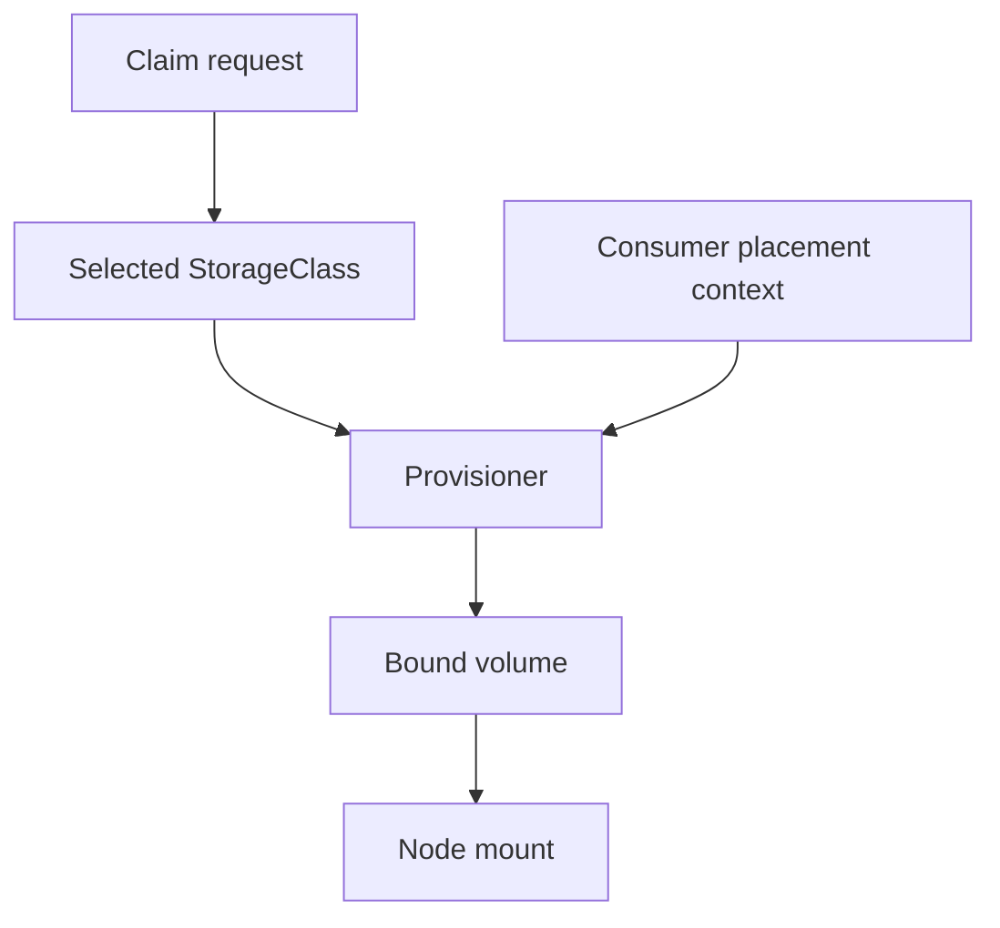

# Provisioning, Classes And Drivers

A claim requests storage, but no volume appears until the selected provisioner can fulfill it. StorageClass parameters, topology and the consumer's node choice can all participate. A Pending claim therefore needs provisioning evidence rather than repeated application restarts.

## Learning objectives

- Explain StorageClass and provisioner responsibilities.
- Distinguish immediate binding from consumer-dependent binding.
- Locate evidence for a claim that cannot be provisioned or mounted.

## Before you start

Use a shell on your own machine with the module playground running. A Pod is Kubernetes's unit for running one or more containers together. The environment provides the `probe` Deployment, which maintains application Pods, and the `starfleet` namespace, which groups these objects.

Read-only commands below use kubectl, the Kubernetes command-line tool. Select the private kubeconfig: the file that identifies this environment's cluster and credentials. The commands do not change the application.

## Provisioning, Classes and Drivers

A team requests storage without asking an operator to create every volume manually. A StorageClass describes a storage offering and identifies a provisioner, with implementation-specific parameters. Dynamic provisioning uses a claim and class to create suitable storage when supported by the infrastructure.

Static provisioning starts with a volume already prepared by an operator. Dynamic provisioning creates the backing resource in response to a claim. A claim can remain unbound when no suitable volume or working provisioning path is available. Merely creating a StorageClass does not install a provisioner or grant it access to an external storage account.

The Container Storage Interface (CSI) defines an integration interface for storage systems and container orchestration. CSI drivers support operations such as provisioning, attaching and mounting according to their capabilities. The Kubernetes control plane, driver components and underlying storage system each contribute to the final mounted volume.

Volume binding can happen immediately or wait until a consuming Pod is considered for placement. `WaitForFirstConsumer` helps align storage provisioning with topology requirements such as a zone. A waiting claim under that mode may be normal before a consumer is scheduled, rather than evidence that the system is broken.

Capacity, access requirements and topology all matter. Storage available only in one zone can restrict where its consumer runs. A node with sufficient CPU can still be unsuitable for the volume. The scheduler and storage binding workflow must reach a compatible decision.

If a claim remains Pending, examine its class, requested properties, binding mode and provisioning evidence. Then distinguish a deliberate wait from a driver or infrastructure failure. Storage troubleshooting needs the claim-to-backend relationship rather than assuming every storage object works independently.

## Provisioning Through A StorageClass

A PVC requests ten gibibytes using a particular StorageClass. The class identifies a provisioner and parameters for its storage offering. A working provisioner can create the external storage resource and the corresponding PV, then enable the binding workflow. The external system must have capacity and the integration must have appropriate credentials and connectivity.

Static provisioning instead starts with a prepared PV whose properties can satisfy the claim. Either route can fail if capacity, class, mode or other requirements do not match. A similarly named PV is not enough; binding uses the resource's actual contract and state.

A CSI driver can implement provisioning, attachment and node mount operations through supported components. Its controller-side and node-side roles can fail independently. Successful provisioning is not proof that the node-side mount completed, and a mounted volume does not prove a distant backend remains healthy.

## Topology-Aware Binding

Immediate binding can select storage before the consuming Pod's location is known. With topology-constrained storage, that choice can make later placement difficult. `WaitForFirstConsumer` allows binding or provisioning to consider the consumer's scheduling needs so storage and node placement can agree.

Suppose the application requires zone A and the requested storage is available only in zone B. More generic CPU capacity does not resolve the mismatch. The desired placement or storage offering must become compatible. If no consumer has been created under delayed binding, a waiting claim can be expected rather than a failure.

A useful diagnosis traces class selection, provisioner availability, backing-resource creation, claim binding, attachment and mounting. Identify the last successful stage and the required location. Storage resource names and a Pending summary alone do not provide enough detail to choose a correct remedy.

## Inspect the mechanism

A StorageClass describes a storage provisioning choice, including its provisioner and supported parameters. A provisioner creates or arranges the backing storage and corresponding volume objects. A Container Storage Interface (CSI) driver is a standardized integration between Kubernetes and storage systems; not every local practice provisioner demonstrates a production CSI backend.

With `WaitForFirstConsumer`, binding or provisioning can wait until a consuming Pod provides placement context. An unused claim can therefore remain Pending without a defect. After a consumer exists, compare its scheduling constraints with allowed storage topology. A successful bind is another boundary: mounting, filesystem permissions and application writes can still fail later.



Provisioning and mounting are separate operations, and some provisioning decisions need consumer placement first.

<!-- astrona:playground:renew -->

Select the private cluster connection and inspect the live state from your host shell:

```sh
export KUBECONFIG="$(astrona kubeconfig ats-027-playground-040-01)"
if test "$(kubectl config current-context)" = "kind-astro-ats-027-playground-040-01"; then
  kubectl get storageclasses -o yaml
  kubectl -n starfleet get persistentvolumeclaims
  kubectl get persistentvolumes -o wide
else
  printf "Select this module's private kubeconfig before continuing.\n" >&2
fi
```

Read `provisioner`, `volumeBindingMode` and `reclaimPolicy` from actual classes. The kind practice cluster uses a local storage arrangement; its behavior does not demonstrate remote replication or all CSI capabilities. Interpret any Pending claim in relation to its consumer and events. A class name alone does not explain when binding should happen.

You can now distinguish a storage request from provisioned and mounted storage. Diagnose the earliest unresolved boundary, while keeping backend-specific capabilities separate from the local practice example.

## Common pitfalls

> [!WARNING]
> A StorageClass is a description, not a storage driver installation. Delayed binding can be intentional and must be interpreted together with the consuming Pod's placement.
