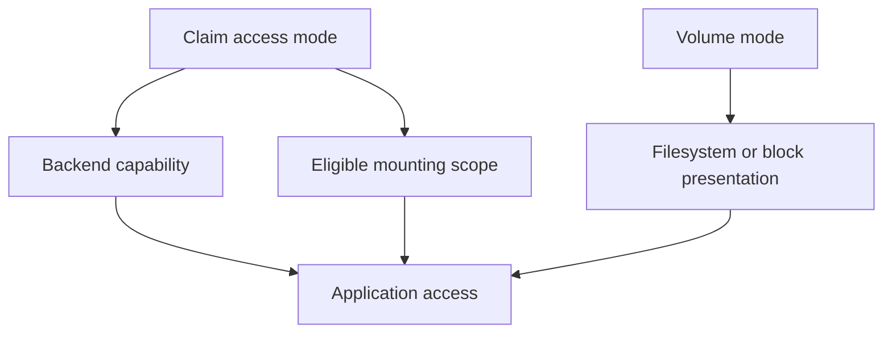

# Access Modes And Data Presentation

Two Pods on the same node may use a ReadWriteOnce volume, even though its name sounds like a single-Pod limit. Access mode describes a storage access constraint, not an application lock. Separate node access from concurrent writers.

## Learning objectives

- Interpret volume access modes at the node and Pod boundaries.
- Distinguish filesystem presentation from raw block presentation.
- Explain why storage access does not serialize application writes.

## Before you start

Use a shell on your own machine with the module playground running. A Pod is Kubernetes's unit for running one or more containers together. The environment provides the `probe` Deployment, which maintains application Pods, and the `starfleet` namespace, which groups these objects.

Read-only commands below use kubectl, the Kubernetes command-line tool. Select the private kubeconfig: the file that identifies this environment's cluster and credentials. The commands do not change the application.

## Access Modes and Data Presentation

Two `probe` Pods need access to stored reports. Access modes describe supported mounting arrangements, not the application's transaction rules. ReadWriteOnce allows read-write mounting by one node, which can include several Pods on that node. It does not universally mean one Pod.

ReadOnlyMany supports read-only mounting by many nodes. ReadWriteMany supports read-write mounting by many nodes where the storage implementation provides it. ReadWriteOncePod restricts a supported volume to a single Pod and requires compatible Container Storage Interface (CSI) support. Not every driver supports every access mode.

Access modes do not make simultaneous application writes consistent. A shared filesystem can be mounted successfully while two writers corrupt their own application data. Applications need locking, coordination or a data service designed for concurrent access. Many replicas are not a reason to assume all their storage must support shared writes.

Volume mode controls how the storage is presented. Filesystem mode exposes a mounted filesystem. Block mode exposes a raw block device for applications that can use it. Choosing block mode does not automatically format the device or make an ordinary file-based application compatible with it.

The storage's topology and failure properties also affect the decision. A volume available on one node or zone may constrain placement. A supported access mode describes the attachment contract, while availability describes whether the storage remains reachable under failures.

Choose from the actual access pattern: one application member with its own data, shared read-only artifacts, or coordinated multi-writer storage. Then check driver capabilities and the application's data model. A storage claim cannot create capabilities that the backend lacks.

## Choosing An Access Pattern For Replicas

A database member may need exclusive access to its own storage, while a document-serving application may allow many readers of shared files. A report system with several writers needs a backend and application protocol that safely coordinate writes. These are different contracts even if all use persistent claims.

ReadWriteOnce permits read-write mounting by one node under the supported arrangement. Several Pods on that same node can therefore be possible consumers. ReadWriteOncePod expresses a single-Pod restriction with compatible CSI support. The stronger mode is relevant when the application requires a single consumer boundary rather than merely a single node.

ReadWriteMany describes a backend-supported multi-node write access pattern. It does not supply database transactions, file-level locks or safe application merge behavior by itself. Two writers can successfully mount a shared volume and still overwrite each other's records. Access success and data correctness are separate evidence.

## Filesystem Versus Raw Device

Filesystem mode presents mounted directories and files. Block mode presents a raw device that the application must know how to use. A file-oriented web application does not automatically become block-aware when its claim changes mode. The backend and driver must support the selected presentation too.

Capacity, performance and availability also differ from access mode. A share supporting many writers can still have insufficient throughput. A volume allowing one node can be attachable in a restricted zone. A large volume can retain data but still depend on one failure-prone device.

A complete storage decision states the consumers, concurrency model, presentation, topology and recovery requirements. Then compare those needs with the supported class and driver behavior. This avoids treating one access-mode abbreviation as a full specification of safe application storage.

## Inspect the mechanism

ReadWriteOnce permits read-write mounting by one node under the backend's supported semantics. It is not a promise that only one process or Pod writes. ReadWriteOncePod provides the stricter single-Pod access contract where the supported CSI driver and cluster features provide it. ReadWriteMany describes supported read-write access by multiple nodes, not safety for arbitrary shared-file application logic.

Volume mode addresses another question. Filesystem mode exposes files through a mounted filesystem; Block mode exposes a raw block device through the supported device mapping. An application expecting directory paths cannot use a block presentation as though it already had files. Inspect mode and backend capability alongside access modes before changing the application.



Mounting scope and data presentation constrain access, while concurrency correctness remains an application responsibility.

<!-- astrona:playground:renew -->

Select the private cluster connection and inspect the live state from your host shell:

```sh
export KUBECONFIG="$(astrona kubeconfig ats-027-playground-040-02)"
if test "$(kubectl config current-context)" = "kind-astro-ats-027-playground-040-02"; then
  kubectl -n starfleet get persistentvolumeclaims -o yaml
  kubectl get persistentvolumes -o yaml
  kubectl get storageclasses
else
  printf "Select this module's private kubeconfig before continuing.\n" >&2
fi
```

Read `accessModes` and `volumeMode` on any claims and bound volumes. The baseline can have no claims yet, so an empty list does not demonstrate or disprove a particular access mode. Availability of a StorageClass does not mean its provisioner supports every requested mode. The read-only inspection establishes what was actually requested and bound.

You can now distinguish mounting permission from safe concurrent use. A valid access mode still requires compatible backend support and an application that handles shared data correctly.

## Common pitfalls

> [!WARNING]
> ReadWriteOnce means one node, not necessarily one Pod. Successful shared mounting does not guarantee safe concurrent application writes.
