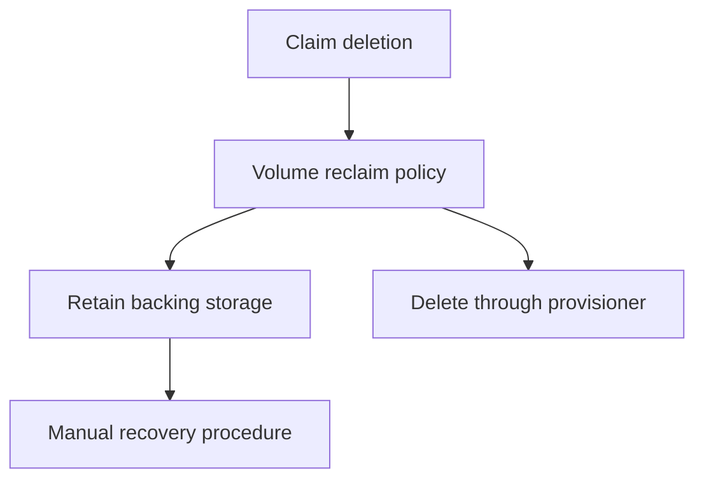

# Reclaim Policies And Recovery

Deleting a Pod and deleting its storage claim are different operations. A retained backend may survive one operation while a Delete reclaim policy removes it after another. Determine ownership and policy before treating resource cleanup as harmless.

## Learning objectives

- Predict the effect of deleting a Pod versus a bound claim.
- Distinguish Retain and Delete reclaim policies.
- Explain why retained storage still needs a recovery procedure.

## Before you start

Use a shell on your own machine with the module playground running. A Pod is Kubernetes's unit for running one or more containers together. The environment provides the `probe` Deployment, which maintains application Pods, and the `starfleet` namespace, which groups these objects.

Read-only commands below use kubectl, the Kubernetes command-line tool. Select the private kubeconfig: the file that identifies this environment's cluster and credentials. The commands do not change the application.

## Reclaim Policies and Recovery

The `probe` workload is removed, but its reports must be retained. Deleting a Pod, deleting its claim and deleting the underlying storage are different operations. A volume's reclaim policy controls what happens to the storage resource after its claim is released.

With Retain, the released volume and underlying data require manual handling rather than automatic reclamation. An operator must assess the data and prepare any reuse. Retention does not automatically rebind the same data to every new claim or guarantee that the application can recover it without a procedure.

With Delete, supported storage integration removes the volume and backing storage as part of reclamation. Actual cleanup can involve finalizers and driver actions. A policy that deletes storage makes claim deletion a significant data lifecycle event; deleting only the application Pod is not the same event.

A StatefulSet can give each application member a stable claim association, but claim retention and deletion behavior depend on its configuration and surrounding lifecycle decisions. Do not assume that deleting one kind of object always cascades to every storage resource. Read the policy that governs the relevant relationship.

Replication and backup remain separate. Replication can preserve availability through a component loss but can also copy a bad write. A backup provides a recovery point, subject to how and when it was created. Application-consistent recovery may require coordinating data across several volumes or an external database.

Before removing storage, identify the owner, retention policy, recovery requirements and a verified backup. For an exam scenario about retained data after claim deletion, distinguish the reclaim policy from Pod lifecycle and from a promise of automatic restoration.

## Following Deletion Through The Storage Lifecycle

Start with a Pod using a bound claim. Deleting only the Pod can leave the claim and storage intact, allowing a suitable replacement to reuse the data. Deleting the claim releases the association and brings the PV's reclaim policy into consideration. Deleting an application controller can have additional effects depending on its configured relationships and retention policy.

With Retain, the released storage needs manual handling. An operator may need to preserve data, assess ownership and prepare a controlled reuse or cleanup procedure. A new claim with a familiar name does not automatically establish that it receives the previous data. The retained resource's state and rebinding procedure matter.

With Delete, the storage integration can remove both the volume representation and its backing resource. Finalizers can keep the object visible while cleanup proceeds. A deletion timestamp therefore does not necessarily mean the external data is already gone, but it also does not make ongoing retention a safe assumption.

## Recovery Beyond Object Existence

A backup must cover the important data and be usable in a realistic restore procedure. A crash-consistent volume copy captures one kind of state; an application-consistent backup may coordinate transactions and several related data stores. The chosen method should match what the application needs to recover correctly.

Replication can preserve operation after one device or member fails but also repeat accidental or malicious changes. Historical recovery requires an appropriate earlier state, with retention and access controls. A retained PV is useful only if the operator can find it, mount it safely and recover meaningful application data.

Before deletion, identify the data owner, governing lifecycle policies and acceptable recovery outcome. After restoration, verify application records rather than only successful mounting. Storage cleanup and recovery are data-management decisions, not interchangeable ways to remove a workload from a cluster.

## Inspect the mechanism

A claim's binding connects an application request to a volume. When the claim is removed, the volume's reclaim policy determines the next storage lifecycle action under the provisioner's contract. `Retain` leaves storage for deliberate handling; it does not automatically bind the old data to a new claim or verify that an application can read it safely.

The policy on an existing volume is the relevant evidence for that volume. Changing a StorageClass default affects subsequently provisioned volumes rather than rewriting every already bound object. Before cleanup, record the current claim-to-volume relationship and the backend's actual retention behavior. Recovery also needs compatible data formats, permissions and a tested application procedure.



The reclaim policy governs storage handling after claim deletion; retention still needs deliberate recovery.

<!-- astrona:playground:renew -->

Select the private cluster connection and inspect the live state from your host shell:

```sh
export KUBECONFIG="$(astrona kubeconfig ats-027-playground-040-02)"
if test "$(kubectl config current-context)" = "kind-astro-ats-027-playground-040-02"; then
  kubectl get persistentvolumes -o custom-columns=NAME:.metadata.name,CLAIM:.spec.claimRef.name,POLICY:.spec.persistentVolumeReclaimPolicy,PHASE:.status.phase
  kubectl get storageclasses -o yaml
else
  printf "Select this module's private kubeconfig before continuing.\n" >&2
fi
```

The custom columns show each volume's recorded claim association, reclaim policy and phase. Compare that policy with the class defaults without assuming they must still match. No deletion runs here. A retained or released volume is evidence about lifecycle state, not proof that the original application data is recoverable or backed up.

You can now separate workload cleanup from storage deletion and recovery. A retention decision preserves an opportunity to recover data, while backups and a tested restoration process establish how that recovery can succeed.

## Common pitfalls

> [!WARNING]
> Delete can remove backing storage after claim release. Retain keeps data for manual handling; it does not provide automatic recovery or replace a backup.
