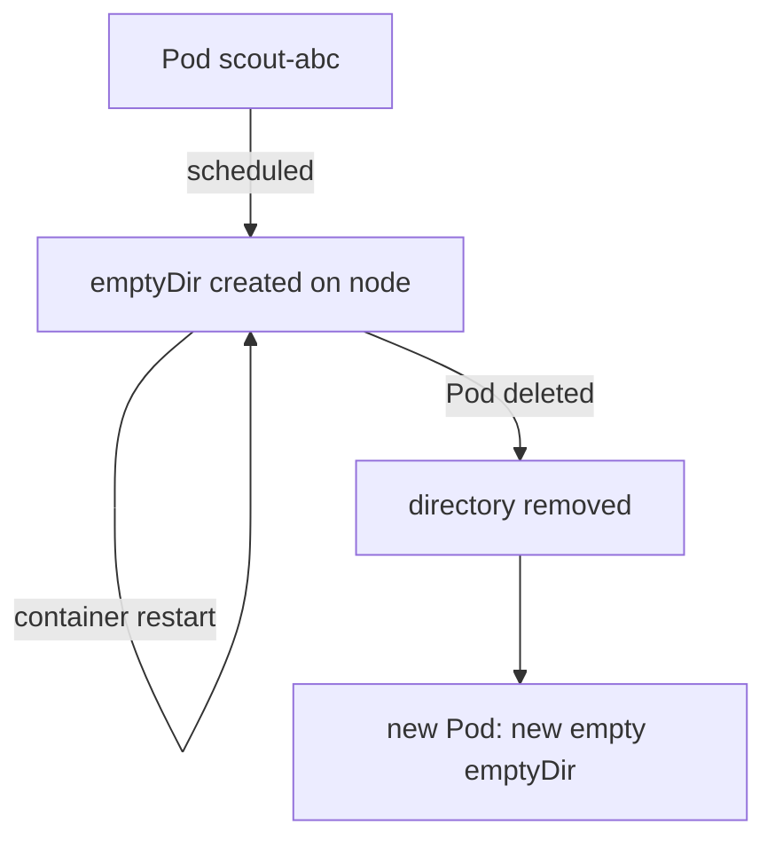

# emptyDir Medium And Size Limits

Many applications need a directory that is private to one Pod, fast to create, and empty at the start. A web server needs a place for temporary uploads. An init container needs a place to hand files to the main container. The container file system is the wrong place for this data, because the kubelet (the agent on each node that runs the Pod's containers through the container runtime) creates a fresh container layer every time a container restarts. The `emptyDir` volume solves this problem.

This part explains who creates an `emptyDir`, how long it lives, what the `medium` and `sizeLimit` fields change, and what happens when the volume grows too large.

## How an emptyDir lives and dies

An `emptyDir` is a directory that the kubelet creates on the node when the scheduler has assigned the Pod to that node. The directory starts empty. The kubelet then bind-mounts it into every container that lists the volume in `volumeMounts`. Different containers in the Pod can mount it at different paths, and they all see the same files.

The life of the directory follows the Pod, not the container. When a container crashes or is restarted by the kubelet, the Pod object stays on the same node, so the kubelet keeps the directory and mounts it again into the new container. The files are still there. When the Pod is deleted, evicted or replaced by a controller, the kubelet removes the directory and its contents. A new Pod from the same Deployment gets a new, empty directory, even if it lands on the same node.

The playground already runs the `scout` Deployment, which has an `emptyDir` named `scratch` mounted at `/scratch`. Its container appends one line to `/scratch/starts` each time it starts. Define two helper functions first, so the commands stay short:

<!-- astrona:playground:renew -->

```sh
scout_pod() {
  kubectl -n starfleet get pod -l app=scout -o jsonpath='{.items[0].metadata.name}'
}
restart_scout_container() {
  kubectl -n starfleet exec "$(scout_pod)" -- kill 1
}
```

The function `restart_scout_container` runs `kill 1` inside the container. Process ID 1 is the container's main shell, which has a handler that makes it exit with an error. The kubelet notices that the container exited and starts it again in the same Pod. Run it, then read the file:

```sh
restart_scout_container
kubectl -n starfleet exec "$(scout_pod)" -- cat /scratch/starts
```

Wait a few seconds after the restart before you read the file. The file now has two lines, one for each start. The command `kubectl -n starfleet get pods` shows a `RESTARTS` count of 1, and the Pod name did not change. The data survived because the kubelet kept the directory.

Now replace the Pod:

```sh
kubectl -n starfleet delete pod "$(scout_pod)"
kubectl -n starfleet rollout status deploy/scout
kubectl -n starfleet exec "$(scout_pod)" -- cat /scratch/starts
```

The Deployment controller creates a new Pod because the ReplicaSet wants one replica. The new file has one line. The old directory went away with the old Pod.



The diagram shows that a container restart keeps the same directory, while deleting the Pod removes it and the next Pod starts with a new one.

## Medium and size limits

By default the kubelet creates the directory on the node's own disk, in the area that holds Pod data. This storage is called node ephemeral storage. Container writable layers, container logs and disk-backed `emptyDir` volumes all use it. A Pod that writes a lot into an `emptyDir` can fill the node disk, so Kubernetes lets you cap it.

The field `sizeLimit` sets a maximum size for the volume. For a disk-backed `emptyDir`, the kubelet checks the usage periodically. When the usage is above the limit, the kubelet evicts the Pod: it stops the containers and marks the Pod as failed with reason `Evicted`. The check is periodic, so the Pod can write over the limit for a short time before the eviction happens. The limit is an eviction rule, not a hard quota on every write.

The field `medium: Memory` tells the kubelet to mount a `tmpfs` instead of using disk. A `tmpfs` is a file system that lives in RAM. It is fast, and its files never touch the disk. Its contents still disappear when the Pod is removed, and also when the node restarts. Memory-backed files count against the memory limit of the container that wrote them. A container with `limits.memory: 64Mi` that writes `50Mi` into a `tmpfs` has only about `14Mi` left for its own process, and the kernel can kill it with an out-of-memory error if the total goes over the limit.

The kubelet also uses `sizeLimit` to size the `tmpfs`. A write that goes past the limit fails with the error "No space left on device". Without a `sizeLimit`, the `tmpfs` size follows the memory available to the Pod. Always set both a `sizeLimit` and a memory limit for a memory-backed volume, and keep the limit lower than the memory limit.

Save this as `pod-shuttle-memory.yaml`:

```yaml
apiVersion: v1
kind: Pod
metadata:
  name: shuttle
  namespace: starfleet
spec:
  containers:
    - name: app
      image: docker.io/library/busybox:1.37.0
      command: ["sh", "-c", "while true; do sleep 3600; done"]
      resources:
        limits:
          memory: 64Mi
      volumeMounts:
        - name: cache
          mountPath: /cache
  volumes:
    - name: cache
      emptyDir:
        medium: Memory
        sizeLimit: 16Mi
```

Apply it:

```sh
kubectl apply -f pod-shuttle-memory.yaml
```

Then check the result:

```sh
kubectl -n starfleet wait --for=condition=Ready pod/shuttle --timeout=60s
kubectl -n starfleet exec shuttle -- df -h /cache
```

The `df` command reports a file system of type `tmpfs` that is about `16Mi` in size. Try to write `32Mi` with `dd if=/dev/zero of=/cache/big bs=1M count=32`. The write stops with a "No space left on device" error, because the kubelet sized the `tmpfs` from `sizeLimit`.

## hostPath and subPath

A `hostPath` volume mounts a file or directory that already exists on the node into the Pod. It looks like an `emptyDir`, but its rules are different. The data is not removed with the Pod, so it lives on the node and only on that node. A replacement Pod on another node sees different files. The Pod can also read and write node files outside its own data, and a Pod that mounts a system directory such as `/etc` or `/var/run` can change the node itself. Cluster administrators often block `hostPath` with a policy for this reason. Use `emptyDir` for scratch data and a PersistentVolumeClaim for durable data.

The field `subPath` on a `volumeMount` mounts one subdirectory of a volume instead of the whole volume. Two containers can then share one `emptyDir` and still see separate directories. The `subPath` value is relative to the volume root and the kubelet creates the directory when it does not exist.

## What you know now

You know that the kubelet creates an `emptyDir` when the Pod is scheduled, keeps it across container restarts, and removes it with the Pod. You know that `medium: Memory` gives a `tmpfs` that counts against the memory limit, and that `sizeLimit` caps the volume. The next question is how to get real, provisioned storage that also disappears with the Pod, which a generic ephemeral volume does.

## Common pitfalls

> [!WARNING]
> - Do not store data in an `emptyDir` that must survive a Pod replacement. A Deployment rollout, a node drain or an eviction all create a new, empty directory.
> - A memory-backed `emptyDir` counts against the container memory limit. A large `tmpfs` with a small limit ends in an out-of-memory kill or an eviction.
> - A `sizeLimit` on a disk-backed volume is enforced by periodic eviction, not by a failed write. Do not rely on it as a precise quota.
> - A `hostPath` volume gives the Pod access to the node. Do not use it for application data.
