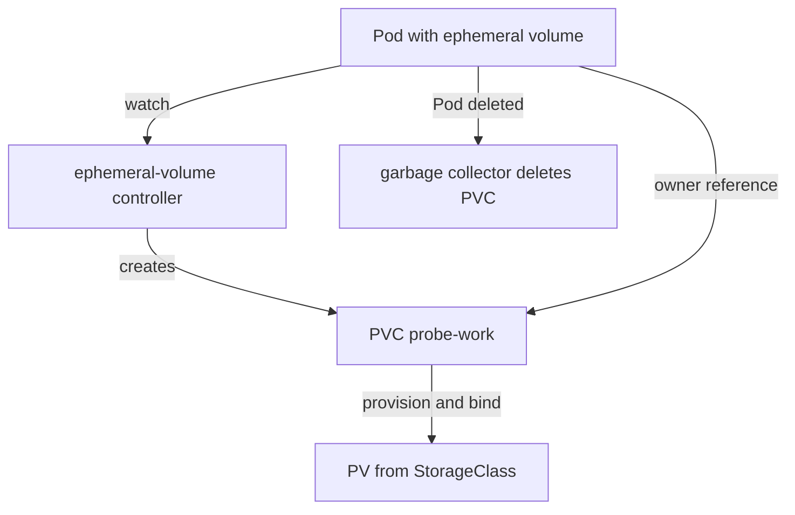

# Generic Ephemeral Volumes

An `emptyDir` lives on the node disk or in memory. That is enough for small scratch data, but some Pods need more. A data processing job may need tens of gigabytes of scratch space, a specific storage class, or a volume that comes from a storage driver with features the node disk lacks. The job still wants the volume to disappear when the Pod ends, so that nobody has to clean up. A generic ephemeral volume gives the Pod this: provisioned storage with a Pod-sized lifetime.

This part shows how to declare one, which controller turns the declaration into a PersistentVolumeClaim, how that claim is named and removed, and how the volume differs from a normal claim that you create yourself.

## Declaring the volume

A PersistentVolumeClaim (PVC) is a request for storage in a namespace. A StorageClass tells the cluster which storage driver (provisioner) creates the volume for a claim. In a normal setup you write the PVC as its own object, and the Pod refers to it by name with `persistentVolumeClaim.claimName`.

A generic ephemeral volume puts the claim inside the Pod instead. In `spec.volumes`, the entry has an `ephemeral` field with a `volumeClaimTemplate`. The template has the same `spec` as a PVC: `accessModes`, `storageClassName` and `resources.requests.storage`. It can also carry `metadata.labels` and `metadata.annotations`, which the controller copies to the claim.

Save this as `pod-probe-ephemeral.yaml`:

<!-- astrona:playground:renew -->

```yaml
apiVersion: v1
kind: Pod
metadata:
  name: probe
  namespace: starfleet
spec:
  containers:
    - name: app
      image: docker.io/library/busybox:1.37.0
      command: ["sh", "-c", "echo hello > /work/note; while true; do sleep 3600; done"]
      volumeMounts:
        - name: work
          mountPath: /work
  volumes:
    - name: work
      ephemeral:
        volumeClaimTemplate:
          metadata:
            labels:
              purpose: scratch
          spec:
            accessModes: ["ReadWriteOnce"]
            storageClassName: standard
            resources:
              requests:
                storage: 1Gi
```

Apply it:

```sh
kubectl apply -f pod-probe-ephemeral.yaml
```

Then check the result:

```sh
kubectl -n starfleet wait --for=condition=Ready pod/probe --timeout=120s
kubectl -n starfleet get pvc
```

The list of claims now contains a claim named `probe-work`. You did not write a PVC object. The name is the Pod name, a dash, and the volume name. The claim status is `Bound`, and its storage class is `standard`.

## Who creates the claim and who removes it

The work is done by the ephemeral-volume controller, which runs inside the `kube-controller-manager`. It watches Pods. When it sees a Pod with an `ephemeral` volume, it creates a PVC in the same namespace with the name `<pod-name>-<volume-name>` and the fields from the template. It also sets an owner reference on the claim that points to the Pod. An owner reference tells the garbage collector that the claim depends on the Pod.

The rest is the normal storage path. The `kube-scheduler` places the Pod, the provisioner for the `standard` StorageClass creates a volume, the volume controller binds claim and volume, and the kubelet mounts the volume into the container. The storage class in `kind` uses the volume binding mode `WaitForFirstConsumer`, so the volume is created only after the scheduler has chosen the node.

Check the owner of the claim:

```sh
kubectl -n starfleet get pvc probe-work -o jsonpath='{.metadata.ownerReferences[0].kind}{" "}{.metadata.ownerReferences[0].name}{"\n"}'
```

The output is the kind `Pod` and the Pod name `probe`. Now delete the Pod:

```sh
kubectl -n starfleet delete pod probe
kubectl -n starfleet get pvc
```

The garbage collector removes the claim because its owner is gone. What happens to the volume behind it depends on the reclaim policy of the StorageClass. The `standard` class uses `Delete`, so the volume is removed too. With a `Retain` class the claim would be removed but the volume would stay and need manual cleanup.



The diagram shows that the controller creates the claim, the Pod owns it, and deleting the Pod removes the claim through the garbage collector.

## Comparing with a normal claim

A normal PVC is an independent object. You create it, and it stays until you delete it. Many Pods, one after another, can mount it, and its data survives every Pod replacement. A generic ephemeral volume belongs to one Pod. A Deployment that has an ephemeral volume in its template gets a separate claim per Pod, for example `scout-6d9f7c-abcde-work`, and a rollout creates new claims and removes the old ones with their data.

Two other differences matter. First, the template is part of the Pod spec, so you cannot change the size of an existing ephemeral claim by editing the Pod. Second, you do not need permission to create PVC objects directly. The controller creates the claim for you, and a cluster administrator can use this fact to control who may request storage. Choose a normal PVC for data that must outlive the Pod, and an ephemeral volume for working space that must not.

## What you know now

You know that a generic ephemeral volume holds a claim template, that the ephemeral-volume controller creates a PVC named `<pod>-<volume>` with the Pod as owner, and that the claim and its storage are removed with the Pod. You also know how the volume differs from a normal PVC. The data in this volume is as short-lived as an `emptyDir` across Pod replacement, but it can sit on any storage class and any size.

## Common pitfalls

> [!WARNING]
> - Do not put durable data in a generic ephemeral volume. Deleting the Pod deletes the claim, and with a `Delete` reclaim policy the data goes too.
> - Do not look for a PVC manifest in your repository. The claim exists only while the Pod exists, and its name changes with every new Pod name.
> - A claim that stays `Pending` blocks the Pod in `Pending`. Check the StorageClass name and the access mode in the template, and read the claim events with `kubectl describe pvc`.
> - Editing a running Pod cannot change the volume template. Create a new Pod or change the Deployment template.
