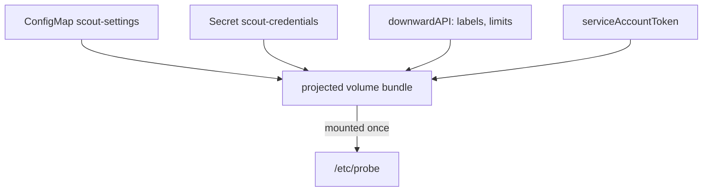

# Projected And Downward API Volumes

A real application often needs several inputs in one place: a settings file from a ConfigMap, a credential from a Secret, a token that proves its identity to the API server, and a few facts about itself. With separate volumes, each one needs its own mount path, and the application has to know all of them. A projected volume merges these sources into one directory, and a downward API source adds Pod facts to the same directory.

This part shows how a projected volume combines sources, how a service account token is projected with a limited lifetime, and how the downward API puts labels and resource limits into files.

## Merging sources into one directory

A `projected` volume has a list called `sources`. Each source is one of `configMap`, `secret`, `downwardAPI`, `serviceAccountToken` and a few others. The kubelet builds one directory that contains the files from all sources, then mounts that directory once. Every file keeps its own `path` inside the directory, so the sources must not use the same path.

All sources must be in the namespace of the Pod. The `defaultMode` field is set on the volume, and each item can override it with its own `mode`. As with a plain ConfigMap or Secret volume, the kubelet writes the files through a `..data` link and refreshes them after a change. A container that mounts one projected file with `subPath` does not get updates.

The downward API (application programming interface) is the part of the Pod API that lets a container read facts about its own Pod without calling the API server. In a volume, the `downwardAPI` source lists items with a `path` and either a `fieldRef` or a `resourceFieldRef`. A `fieldRef` names a Pod field, for example `metadata.labels`, `metadata.annotations`, `metadata.name` or `metadata.namespace`. A `resourceFieldRef` names a container resource, for example `limits.memory` or `requests.cpu`. It needs `containerName` in a volume, and it can set a `divisor` to choose the unit, so `1Mi` turns a limit of 64 mebibytes into the number 64.

## A projected volume with every source

The Secret `scout-credentials` and the ConfigMap `scout-settings` already exist in the playground. Save this as `pod-probe-projected.yaml`:

<!-- astrona:playground:renew -->

```yaml
apiVersion: v1
kind: Pod
metadata:
  name: probe
  namespace: starfleet
  labels:
    app: probe
    tier: edge
spec:
  containers:
    - name: app
      image: docker.io/library/busybox:1.37.0
      command: ["sh", "-c", "while true; do sleep 3600; done"]
      resources:
        limits:
          memory: 64Mi
      volumeMounts:
        - name: bundle
          mountPath: /etc/probe
          readOnly: true
  volumes:
    - name: bundle
      projected:
        defaultMode: 0440
        sources:
          - configMap:
              name: scout-settings
              items:
                - key: app.properties
                  path: settings/app.properties
                  mode: 0444
          - secret:
              name: scout-credentials
              items:
                - key: api-key
                  path: secret/api-key
                  mode: 0400
          - downwardAPI:
              items:
                - path: meta/labels
                  fieldRef:
                    fieldPath: metadata.labels
                - path: meta/memory-limit
                  resourceFieldRef:
                    containerName: app
                    resource: limits.memory
                    divisor: 1Mi
          - serviceAccountToken:
              path: token/api-token
              audience: probe-api
              expirationSeconds: 3600
```

Apply it:

```sh
kubectl apply -f pod-probe-projected.yaml
```

Then check the result:

```sh
kubectl -n starfleet wait --for=condition=Ready pod/probe --timeout=60s
kubectl -n starfleet exec probe -- find /etc/probe -type f
kubectl -n starfleet exec probe -- stat -L -c '%a %n' /etc/probe/settings/app.properties /etc/probe/secret/api-key /etc/probe/meta/labels
```

The `find` command lists the four files that the sources created. The `stat` command shows mode `444` for the settings file, `400` for the key and `440` for the labels file, which has no item `mode` and so takes `defaultMode`. All of these files come from one mount, `/etc/probe`.

## The token and the labels file

The `serviceAccountToken` source asks the kubelet to request a token for the Pod's service account from the API server through the TokenRequest API. The token is a signed JSON Web Token (JWT) that names the audience you set. The default audience is the API server, so a custom `audience` such as `probe-api` makes a token that only a service that expects that audience should accept. The field `expirationSeconds` sets the lifetime. The default is one hour, and the minimum is 10 minutes. The kubelet refreshes the file before the token expires, and the token is bound to the Pod, so deleting the Pod invalidates it.

The labels file lists one label per line in the form `key="value"`. A downward API volume refreshes it when the labels change, and an environment variable would not. Change a label and read the file again:

```sh
kubectl -n starfleet label pod probe tier=core --overwrite
kubectl -n starfleet exec probe -- cat /etc/probe/meta/labels
```

Wait about a minute after the label change. The file now has the line `tier="core"`. The file `meta/memory-limit` contains the number 64, because `limits.memory` is `64Mi` and the divisor is `1Mi`. The kubelet sets the memory limit once at start, so this file stays fixed unless the Pod is replaced.



The diagram shows four sources merged by the kubelet into one projected volume that the container mounts at one path.

## What you know now

You know that a projected volume merges sources into one directory with per-item modes, that a service account token can be projected with its own audience and lifetime, and that the downward API puts Pod labels and container limits into files. Labels in a volume update after a change, while container limits do not. You now have the pieces to deliver all of an application's inputs through one mount.

## Common pitfalls

> [!WARNING]
> - Two sources that write the same `path` conflict, and the Pod fails to start. Give each source its own subdirectory.
> - In a volume, a `resourceFieldRef` needs `containerName`. Without it the API server rejects the Pod.
> - A `subPath` mount of a projected or downward API file never updates.
> - A short `expirationSeconds` below 600 is rejected. A token with a custom audience is not accepted by the API server unless that audience is configured.
